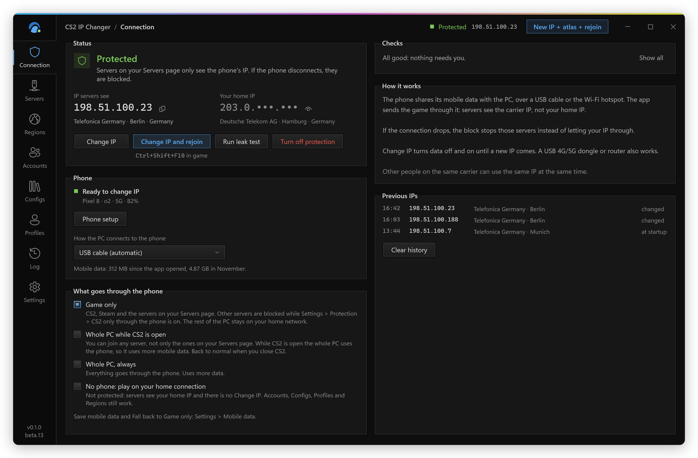
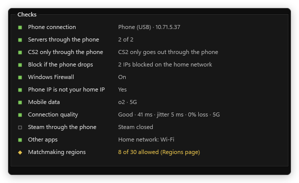
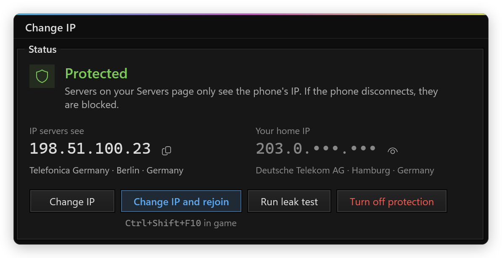
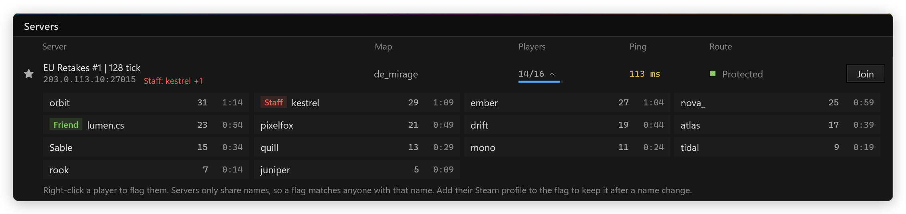
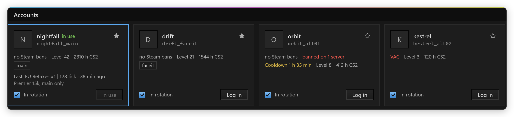
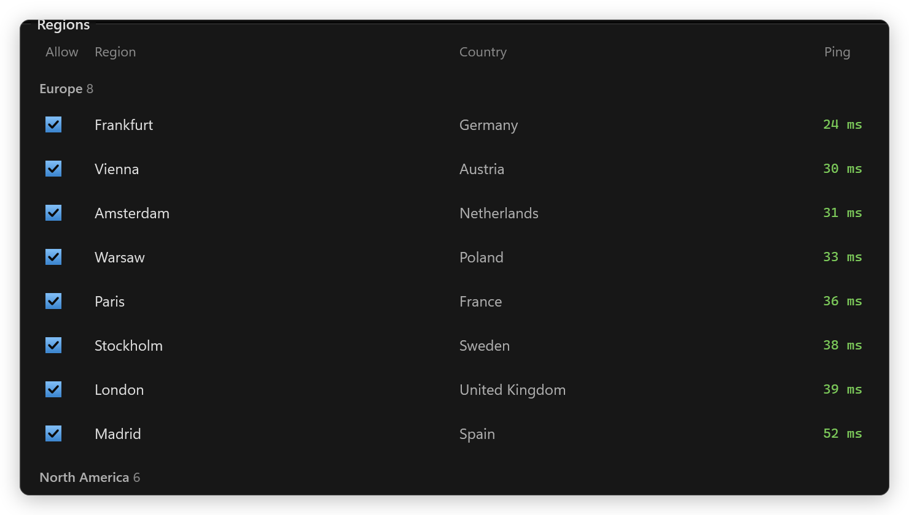
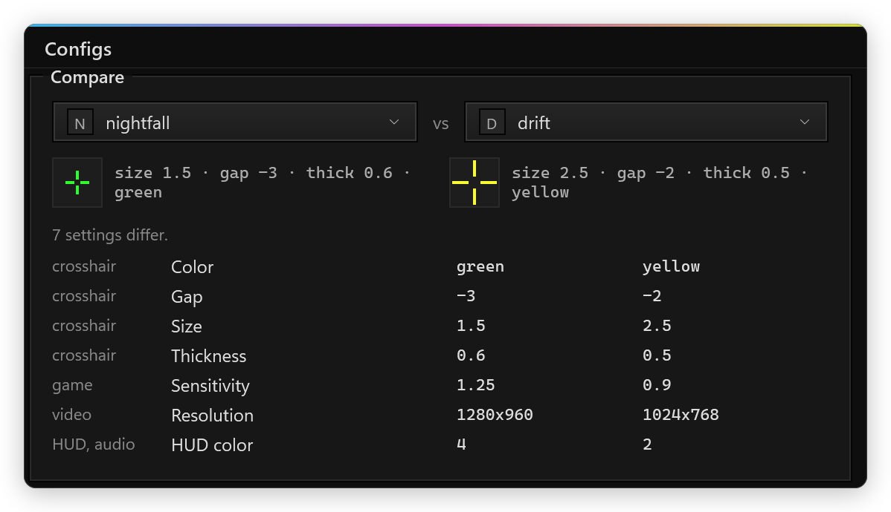

<p align="center">
  
</p>

<h1 align="center">CS2 IP Changer</h1>

<p align="center">
  <b>CS2 IP ban bypass and home IP protection for Counter-Strike 2 community servers. Free, for Windows.</b>
</p>

<p align="center">
  <a href="https://github.com/Sepd0x/cs2-ip-changer/releases/latest">
    <picture>
      <source media="(prefers-color-scheme: dark)" srcset="docs/assets/download-button-dark.svg">
      
    </picture>
  </a>
</p>

<p align="center">
  <a href="https://github.com/Sepd0x/cs2-ip-changer/releases"></a>
  
  <a href="https://github.com/Sepd0x/cs2-ip-changer/attestations"></a>
</p>

<p align="center">
  <a href="https://sepd0x.github.io/cs2-ip-changer/">Website</a>
  &nbsp;·&nbsp;
  <a href="https://sepd0x.github.io/cs2-ip-changer/#guides">Guides</a>
  &nbsp;·&nbsp;
  <a href="#faq">FAQ</a>
</p>

<p align="center">
  <sub>Official downloads only from this page's Releases and the website above. <a href="#check-your-download">Check your download</a>.</sub>
</p>

<p align="center">
  <picture>
    <source srcset="docs/assets/shots/connection.webp" type="image/webp">
    
  </picture>
  <br>
  <sub>The Connection page: the IP servers see next to your home IP (masked), the phone and the live checks.</sub>
</p>

CS2 IP Changer sends CS2 and Steam through your Android phone's mobile data, so community servers see your carrier's IP and not your home IP. Got IP banned? Change the IP from the app and join again; after a ban it can also log into the next account that server hasn't banned.

It isn't a VPN: servers see an ordinary mobile connection, so it also works on servers that block VPNs and datacenter IPs. In the same app: a Steam account switcher, a CS2 config manager, a Steam profile editor and a matchmaking region picker.

## What it solves

| Your problem | What the app does |
|---|---|
| I got IP banned on a CS2 community server | **Change IP** turns the phone's mobile data off and on until the carrier gives a new IP, and can rejoin with the next account that server hasn't banned (<kbd>Ctrl</kbd>+<kbd>Shift</kbd>+<kbd>F9</kbd>). |
| The server blocks my VPN | Servers see an ordinary mobile IP from your carrier, not a datacenter. No VPN server in between. |
| I don't want servers to see my home IP | Only CS2 and Steam go through the phone, with a firewall kill switch: if the phone drops, CS2 is blocked instead of falling back to your home connection. |
| I have several Steam accounts | Account switcher with VAC, game and trade bans, cooldowns and ban marks per server. |
| I want the same binds and crosshair on every account | Configs copies CS2's own config files between your accounts, with backups. |
| Matchmaking puts me on far regions | Regions blocks the Valve relays you don't want, from a map. |

> [!WARNING]
> This is a beta, so expect bugs. If something breaks your connection, **Turn off protection** (on Connection, or in the icon's menu next to the clock) removes the routes and firewall rules (`CS2IPChanger.exe --restore` removes the region block too).

## Quick start

You need Windows 10 or 11 (64-bit), admin rights and an Android phone with mobile data.

1. **Download** `CS2IPChanger.exe` (about 66 MB) from the [latest release](https://github.com/Sepd0x/cs2-ip-changer/releases/latest) and put it in a folder only admins can change, like `C:\Program Files\CS2 IP Changer`. Started from Downloads or the Desktop, the app itself doesn't run there: it opens a window that offers to install it in that folder (Install copies the exe and your `SRT_Dados` and starts it from there; nothing is moved).
2. **Connect the phone.** Plug it in by USB, turn on USB tethering and turn off the phone's Wi-Fi.
3. **Open the app** (it asks for admin). Open **Phone setup** (under Phone): each step checks itself and turns green, and where the app can do a step it has a button. Paste the servers you play on into **Servers**, then press **Turn on protection** in Status. Protection starts off each time the app opens (Settings > Protection can turn it on by itself).
4. **Check.** Open **Connection** with CS2 and Steam running. Every check should be green, and the IP servers see must not be your home IP.

> [!NOTE]
> The exe isn't code-signed, so Windows SmartScreen may warn you the first time you run it. Click **More info > Run anyway**, or [check your download](#check-your-download) first.

More detail on each step in [Setup](#setup).

## Is it safe?

**It keeps its hands off the game.** It never touches the game process, its memory or its program files. It changes Windows routes and firewall rules, and which Steam account logs in. If you use them, the Configs page copies CS2's own config files (binds, crosshair, video and so on) between your accounts, the same files CS2 writes when you change a setting, and the Profiles page changes your Steam profiles. It won't hide a cheat from VAC or any other anti-cheat, so don't use it for that.

**Why it needs admin.** Routes and firewall rules are system settings, and Windows only lets admins change them. That's also why the exe has to live in a folder only admins can change: from Downloads or the Desktop it doesn't start.

**Updates are signed.** Once a day at most the app checks for a new version (you can turn this off). It installs one only if the exe matches the release's SHA-256 and that `.sha256` file is signed with the project's own key, which is kept off GitHub. So someone who got into this repo or its releases still couldn't push an exe of their own to your PC.

**No account. Usage stats, required to use the app.** At the first start the beta shows what it sends once a day (Accept or Quit): a random ID made for this install, with no name, versions, your country as two letters, the mode and counters. Never IPs, accounts, names or server addresses. Nothing is sent before you accept, and Quit closes the app without changing anything. [What is sent](#telemetry).

**Easy to undo.** Turn off protection removes the routes and firewall rules and checks that they're gone. `CS2IPChanger.exe --restore` removes everything, the region block too. More in [If something goes wrong](#if-something-goes-wrong).

**Everything it does with admin rights, and why an antivirus may flag it**, is listed in [Privacy and security](docs/PRIVACY-AND-SECURITY.md): each Windows function it calls, each service it talks to and what each one gets, and the known limits.

### Check your download

Releases built by GitHub Actions come with a `CS2IPChanger.exe.sha256` file and a build attestation, which shows the exe was built from this repository's code.

<details>
<summary><b>How to check them</b></summary>

To check the attestation, install the [GitHub CLI](https://cli.github.com/), sign in once with `gh auth login` and run:

```powershell
gh attestation verify CS2IPChanger.exe -R Sepd0x/cs2-ip-changer
```

To check only the hash, put the `.sha256` file next to the exe and run this in PowerShell. It prints `True` if they match:

```powershell
(Get-FileHash .\CS2IPChanger.exe).Hash -eq (Get-Content .\CS2IPChanger.exe.sha256).Split()[0]
```
</details>

Each release is also scanned on VirusTotal. beta.9: [0 of 69 engines](https://www.virustotal.com/gui/file/441e9ae0c8def2de90c83cfdec3c531a963a8370d5418a5ae0c7f43887bd6517/detection) flag it.

<details>
<summary><b>Which engines, and why some flag it</b></summary>

The two are Google and Varist. Microsoft, Kaspersky, ESET, Bitdefender and Avast find nothing. An exe that isn't code-signed, asks for admin and changes firewall rules gets flagged by some engines on heuristics alone. If you see a detection that looks wrong, open an issue.
</details>

## How it works

<picture>
  <source media="(max-width: 600px)" srcset="docs/assets/how-it-works-mobile.svg">
  <source media="(prefers-color-scheme: dark)" srcset="docs/assets/how-it-works-dark.svg">
  
</picture>

The phone shares its mobile data with the PC over USB tethering (or its hotspot). The app routes CS2, Steam and your servers through it and blocks them on your home connection, so those servers only see the carrier's IP. Your home IP stays out of their logs and ban lists, away from the admins and the plugins they run, and off screen when you stream. Other players never see your IP either way.

### CS2 IP Changer or a VPN?

| | CS2 IP Changer | VPN or proxy |
|---|---|---|
| Server sees | Your carrier's mobile IP, like any player on a phone hotspot | An IP from the VPN's datacenter |
| Servers that block VPNs | Works: it's an ordinary mobile connection | Often blocked |
| New IP | One click: mobile data off and on over ADB | Connect to another VPN server |
| Cost | Free, uses your phone's data plan | Usually a subscription |
| What goes through | CS2, Steam and your servers, or the whole PC if you pick it | Usually the whole PC |
| If it drops | Windows Firewall blocks it (a kill switch): CS2 loses the connection instead of using your home IP | Depends on the VPN app |

<a id="what-it-does"></a>
## Features

Every feature in detail: [docs/FEATURES.md](docs/FEATURES.md).

<picture>
  <source srcset="docs/assets/shots/crop-protection.webp" type="image/webp">
  
</picture>

### Protection
- **Game-only routing.** CS2, Steam and your servers go through the phone; your browser, Discord and downloads stay at home. Or send the whole PC through it.
- **Block if the phone drops.** A Windows Firewall rule keeps CS2 and your servers on the phone. If the cable comes out, the game loses connection instead of using your home IP.
- **Live checks.** Windows Firewall, routes, the IP servers see next to your home IP, mobile data on the phone, Steam on the same connection as the game, where other apps go, and a leak test.
- **Connection quality.** Ping, jitter and loss through the phone every 30 seconds, with a warning when it's weak.
- **No phone mode.** Play on your home connection: nothing is blocked and servers see your home IP. Accounts, Configs, Profiles and Regions keep working.

<br clear="right">

<picture>
  <source srcset="docs/assets/shots/crop-change-ip.webp" type="image/webp">
  
</picture>

### Change IP
- **Change IP.** Mobile data (or airplane mode) off and on over ADB until the carrier hands you a new IP.
- **Change IP and rejoin.** After a kick or ban: a new IP and back on the last server, also from inside the game with <kbd>Ctrl</kbd>+<kbd>Shift</kbd>+<kbd>F10</kbd>. After a ban it also logs into the next account that server hasn't banned.
- **Knows a kick from a ban.** On community servers the app reads why CS2 left: a ban (with its length when the server says it), a VPN or proxy block, a kick (AFK, vote, admin), a full server, a timeout, a map change or you leaving. Only a ban or a VPN block offers New IP + next account; a kick offers a rejoin; a timeout says it was the connection. Valve's matchmaking servers are left alone.
- **New range check.** Tells you if the new IP is in a new /16, because some admins ban whole ranges, and can keep trying until it is.

<br clear="right">

<picture>
  <source srcset="docs/assets/shots/crop-servers.webp" type="image/webp">
  
</picture>

### Servers
- **Server list.** Paste `IP:port`, `connect` or `steam://connect/` links, see name, map, players and ping, and join in one click. On a full server it waits for a slot.
- **Players and flags.** See who is on a server and flag players as Staff or with your own label, by name or Steam profile link.
- **Follow a player.** A sound and a Join notice when someone you follow shows up on another server in your list.
- **Server bans.** A ban in CS2's console marks that account for the server and its community, and joining there with it asks first.

<br clear="right">

<picture>
  <source srcset="docs/assets/shots/crop-accounts.webp" type="image/webp">
  
</picture>

### Accounts
- **Account switcher.** Uses the logins Steam already saved, no passwords. **New IP + next account** (the button shows that account's name; <kbd>Ctrl</kbd>+<kbd>Shift</kbd>+<kbd>F9</kbd> does the same, even mid-game) gets a new IP, logs into the next account and joins the last server again.
- **Bans and cooldowns.** VAC, game and trade bans and the cooldown of each account. New IP + next account skips accounts on cooldown, marked on that server or not in rotation.

<br clear="right">

<picture>
  <source srcset="docs/assets/shots/crop-regions.webp" type="image/webp">
  
</picture>

### Regions
- **Pick your matchmaking regions.** Each region with its ping; turn them on or off, or use Only this region, Closest 3, your continent only or Ping under X ms.
- **Blocks only the relays.** One Windows Firewall rule for `cs2.exe`, on Valve's relay IPs only. Steam, friends and community servers aren't touched.

<br clear="right">

<picture>
  <source srcset="docs/assets/shots/crop-configs.webp" type="image/webp">
  
</picture>

### Configs and Profiles
- **CS2 config manager.** Copies binds, crosshair, game settings, video, and HUD, radar and audio between your accounts, each on its own, with backups and Undo. [More](docs/FEATURES.md#cs2-config-manager).
- **Profiles.** Changes the name, picture, bio, country, privacy and custom URL of the accounts you pick, from templates, with a preview first and Restore original. [More](docs/FEATURES.md#profiles).

<br clear="right">

### Also
- **Stream friendly.** Hide usernames, your home IP masked in the app, and the Steam Web API key hidden unless you click Show.
- **Open with CS2.** Discord, Spotify or a stats tracker open with CS2, as you and never with the app's admin rights.
- **Sounds.** A short sound when a command is taken and another when it's done or failed, in game too. They can be turned off.
- **In the background.** An icon next to the clock with Turn protection on or off, New IP + next account, Change IP, Regions and Quit. The X can hide the window there, and the installed copy can start with Windows, in the notification area and without a UAC prompt each time (both off until you turn them on).
- **Mobile data counter.** What went through the phone this session and this month, with a warning at the limit you pick.
- **Hide usernames while you stream.** It turns on by itself while OBS or Streamlabs is open.
- **CS2 friend code.** Copy any account's friend code from its menu.

## Setup

The [Quick start](#quick-start) covers the usual case.

**Where to put the exe.** It runs as admin, so it only starts from a folder that programs without admin rights can't change. A file put next to the exe in Downloads, on the Desktop or in a folder you made yourself would run with admin rights, so from there the app shows what to do and closes (`--restore` still works). Already used it from another folder? Close it and copy `CS2IPChanger.exe` together with its `SRT_Dados` folder to the new one: copying, not moving, gives the folder the new place's permissions.

<details>
<summary><b>The phone, the firewall, ADB, launch options, hotkeys and uninstalling</b></summary>

- **The phone's Wi-Fi.** It has to be off, so the phone shares mobile data and not your home Wi-Fi. While it's on, the app keeps your servers and CS2 blocked.
- **Windows Firewall has to be on.** Third-party firewalls that turn it off (some antivirus suites) leave the app without a kill switch, and it says so.
- **Change IP from the PC.** Also turn on USB debugging on the phone. If ADB isn't installed, the app can download Google's platform-tools for you (about 7 MB).
- **Launch options.** To spot kicks and bans, CS2 needs `-condebug -conclearlog` (the second one starts `console.log` fresh each time, so it doesn't grow forever). The app adds both when it opens CS2, and tells you if they're missing when you start the game from Steam.
- **Hotkeys.** <kbd>Ctrl</kbd>+<kbd>Shift</kbd>+<kbd>F9</kbd> for New IP + next account and <kbd>Ctrl</kbd>+<kbd>Shift</kbd>+<kbd>F10</kbd> for Change IP and rejoin. Change them in Settings > New IP + next account. The app won't take Ctrl+Alt combinations: on many keyboards that's AltGr, which types @ and €.
- **No phone with you?** Pick "No phone: play on your home connection" under What goes through the phone. Nothing is blocked, servers see your home IP, and the app says so. Until a phone has been connected once, CS2 isn't locked, so trying the app without a phone never leaves CS2 unable to connect at home.
- **Hotspot or a 4G/5G dongle** work too: pick them under Connection > How the PC connects to the phone (see the [FAQ](#faq)).
- **Portable.** Settings, servers and accounts are saved in `SRT_Dados` next to the exe. To uninstall, use Uninstall in Windows Settings > Installed apps, or **Remove CS2 IP Changer** at the bottom of Settings: it removes the rules and routes (the region block too), the Start with Windows task, `C:\ProgramData\CS2IPChanger` and the app, and you pick whether `SRT_Dados` (settings and accounts) stays. Without the window, `CS2IPChanger.exe --restore` removes the rules, routes and task; then delete the folder and `C:\ProgramData\CS2IPChanger`.
</details>

## If something goes wrong

The firewall rules stay in place when you close the app, on purpose, so your IP can't leak while it's closed. To undo everything:

- **In the app:** Turn off protection, on Connection or in the icon's menu next to the clock. It removes the routes and rules and checks that they're really gone. Protection stays off until you press Turn on protection. Regions you turned off stay off: Allow all (block off) on Regions lifts them.
- **If the window won't open:** run `CS2IPChanger.exe --restore`. It removes everything, the region block too.
- **If you already deleted the app:** open [tools/restore.cmd](tools/restore.cmd), click Download raw file, right-click the file and pick Run as administrator, then restart the PC.

Lag, or programs opened with CS2 losing their connection? Look at Connection quality in Checks. If it says Weak, the phone connection is the problem: see [Will my ping be worse?](#faq). In Whole PC mode, programs opened with CS2 go through the phone too, so a new IP cuts their connections: use Game only for them.

Found a bug? [Open an issue](https://github.com/Sepd0x/cs2-ip-changer/issues/new/choose) with the version (bottom left of the window) and the diagnostics (Log page > Save bug report).

<details>
<summary><b>What is in the bug report</b></summary>

Save bug report saves a .zip on your Desktop with the log, the app's rules and routes, Steam's connection log, CS2's console and the details of any error the app caught. Your current and last home IP, API key, logins, Steam and player names, SteamIDs, Wi-Fi names, emails and your Windows user are hidden in it, but look through it before you post (older log lines can still hold an older home IP). If you paste the log instead (Copy all), blank out your IPs first.
</details>

## FAQ

**Is it a VPN? Does it work on servers that block VPNs?**<br>
No, it isn't a VPN, and yes, it works there. A VPN sends your traffic through a datacenter, and many community servers block datacenter and VPN IP ranges. This app sends CS2 and Steam through your own phone's mobile data, so the server sees an ordinary mobile connection from your carrier, the same as someone playing on a phone hotspot. There's no VPN server in between and no subscription.

**Can this get me VAC banned?**<br>
It never touches the game process, its memory or its program files. It changes Windows routing and firewall rules and which Steam account logs in. The rest is in [Is it safe?](#is-it-safe)

**Will my ping be worse?**<br>
Usually, yes. Mobile data adds latency and jitter, and some cells drop packets when they're busy, so expect a higher ping than at home and a game that can feel less smooth. A good 5G or 4G signal helps a lot: put the phone near a window, keep it charging and don't run other heavy stuff on it. The ping column in Servers is measured through the phone, so it shows what you'll get before you join, and Connection quality in Checks tells you when the connection itself is weak. What to do when it stays weak is under Phone and connection below.

**Does the account switcher store my Steam password?**<br>
No. It uses the logins Steam already saved on your PC (the accounts where you ticked Remember me). To switch, it tells Steam which saved account to log into and restarts Steam, the same way other Steam account switchers work. Switching never asks for your password or your Steam Guard codes.

The only place you type a password is Sign in on the Profiles page, and only if you want the app to change a profile. Even there it's used once and never saved: the app keeps an encrypted Steam sign-in token instead ([what happens to your login](docs/FEATURES.md#what-happens-to-my-login)). You can also sign in with a QR code from the Steam app and type nothing.

**How do I change my IP in CS2?**<br>
Connect an Android phone by USB with tethering on, then click Change IP (or press <kbd>Ctrl</kbd>+<kbd>Shift</kbd>+<kbd>F10</kbd> in game to change it and rejoin). The phone's mobile data goes off and on (4 seconds by default) until the carrier hands out a new IP. Restarting your home router also changes the IP with many providers, but it can take hours and every device in the house drops.

**Does it need root, or an app on the phone?**<br>
No root and nothing to install on the phone. Change IP uses ADB with USB debugging on (Google's official tool, which the app can download). Without ADB, protection still works; you change the IP by hand with airplane mode.

**Does it work with an iPhone?**<br>
The protection does: an iPhone's USB tethering shows up in Windows like an Android one. Change IP from the PC needs ADB, which only Android has, so on an iPhone you switch airplane mode on and off yourself.

**Is it malware? Why does my antivirus flag it?**<br>
It runs as admin, changes network settings and isn't code-signed, which is what some heuristics look for. Every release is built by GitHub Actions from this source and attested, and [Privacy and security](docs/PRIVACY-AND-SECURITY.md) lists every Windows function it uses with admin rights and why. [Check your download](#check-your-download) before you run it.

**Can it run in the background or start with Windows?**<br>
Yes. Settings > Background and data: the X can hide the window next to the clock, and the copy installed in `C:\Program Files\CS2 IP Changer` can start with Windows, in the notification area, without a UAC prompt each time. Both are off until you turn them on.

**How much mobile data does it use?**<br>
CS2 itself uses little next to a download, but Steam's downloads also go through the phone while it's connected. The Phone box on the Connection page counts what went through the phone this session and this month, and Settings > Background and data warns you at a limit you pick.

<details>
<summary><b>Bans</b> (4 questions)</summary>

**I'm banned on a server. Will this get me back in?**<br>
If it's an IP ban, change IP and join again. A ban on your Steam account follows the account, not the IP, so a new IP won't lift it, and your other accounts aren't affected by it. The app marks that account as banned on that server and its network, and New IP + next account won't pick it there.

**Some admins ban a whole IP range. Does that matter?**<br>
After each change the app tells you whether the new IP is in a new /16 or in the same one as before. If you want it to keep going until the range changes, turn on Settings > Keep changing until the IP is in a new range.

**Does it stop me from getting banned?**<br>
No app can stop an admin from banning you. What it does is keep your home IP out of every server's ban list, so a ban never sticks to your house and getting back in takes a few seconds.

**Does forcing a region get me banned?**<br>
The Regions page doesn't touch the game, its files or its memory. It adds one outbound Windows Firewall rule that stops `cs2.exe` from reaching Valve's relays in the regions you turned off, so CS2 sees those regions as unreachable and matchmaking plays elsewhere. To the game it looks the same as a bad connection to those relays. Still, we can't speak for Valve and can't promise anything about how they treat it. Allow all (block off) removes the rule, and so does `--restore`. Turn off protection and No phone mode leave it on.
</details>

<details>
<summary><b>Your IP</b> (2 questions)</summary>

**Why bother hiding my home IP? Who can see it?**<br>
The admins of every community server you join can see your IP, and so can the plugins they run on it. Other players can't. IP bans are tied to it, and it's in the server's logs. With the phone's IP, nobody on the server side gets your home connection to DDoS it, and after a ban you change IP and keep playing on the same servers.

**My carrier uses CGNAT. Is that a problem?**<br>
No. You share a public IP with other customers and servers see that shared one. Change IP still works, but sometimes the carrier gives you the same IP back, so the app keeps trying (you set how many times).
</details>

<details>
<summary><b>Phone and connection</b> (4 questions)</summary>

**My connection stays weak. What can I do?**<br>
Change IP can put you on another cell, and Game only keeps the rest of the PC off the phone (the app does this on its own while the connection is weak, unless you turn off Fall back to Game only on a weak connection). On the phone you can also check Settings > Connections > Mobile networks > Network mode is set to include 5G. Forcing 5G only helps where the 5G signal is good, and some phones show 5G as 4G (LTE) because 5G there runs on top of 4G.

**Can I use the phone's Wi-Fi hotspot instead of a cable?**<br>
Yes. Connect the PC to the hotspot and pick it under Connection > How the PC connects to the phone. The app remembers the network name, and if Windows jumps back to your home router it blocks everything. Change IP works on the hotspot too if the phone is also plugged in by USB with USB debugging on (the cable is only for ADB, tethering can stay off).

**What about a 4G/5G USB dongle or router?**<br>
It works as the connection. If the app doesn't pick it on its own, choose it under Connection > How the PC connects to the phone: USB network adapters that aren't phones (like a laptop dock's Ethernet) are only used when you pick them. Change IP needs an Android phone with ADB, though.

**In Whole PC mode, websites take a second to open. Why?**<br>
While Whole PC is on, DNS can only leave through the phone and IPv6 is blocked, so nothing goes out from home. Windows may first try your home router's DNS or an IPv6 address, get blocked, and then use the phone. That can add a second or two to the first visit to a site. Game only mode doesn't do this.
</details>

<details>
<summary><b>Running the app</b> (3 questions)</summary>

**Why does it need admin?**<br>
Routes and firewall rules are system settings, and Windows only lets admins change them. That's also why the exe has to live in a folder only admins can change: from any other folder it doesn't start.

**Why does the app want <code>-condebug -conclearlog</code>?**<br>
`-condebug` makes CS2 write its console to `console.log`, which is how the app sees a kick or a ban. `-conclearlog` empties that file each time CS2 starts, so it doesn't grow forever. The app adds both when it opens CS2. If you start CS2 from Steam, add them to the launch options (CS2 > Properties).

**What happens when I close the app?**<br>
Protection stays on, so closing the app can't leak your IP. If you'd rather have it turn off, there's a setting for that. Until a phone has been connected once, CS2 isn't locked, so trying the app without a phone never leaves CS2 unable to connect at home.
</details>

## Privacy

There's no account. While the app is in beta it sends usage stats, which are required to use it ([Telemetry](#telemetry)). Besides that, it only talks to the services below. The full list, with what each service receives and what the app does with admin rights, is in [Privacy and security](docs/PRIVACY-AND-SECURITY.md). Your Steam Web API key stays on your PC, encrypted for your Windows user, in `SRT_Dados/settings.json`. The Profiles sign-ins stay on your PC too, encrypted, in `SRT_Dados/profiles/sessions`.

<details>
<summary><b>The services it talks to, and what for</b></summary>

| What for | Service |
|---|---|
| Your public IP (home and phone) | api.ipify.org, ipv4.icanhazip.com, checkip.amazonaws.com, 1.0.0.1 (Cloudflare) |
| Carrier and city of an IP | ipwho.is (over HTTPS). It receives each IP the app looks up: your home IP and the phone's IP. Each one is asked only through its own connection (home through home, the phone through the phone), so it never sees both coming from one place |
| Profiles, avatars and bans of your accounts, and the public profile of a link you paste in Profiles | steamcommunity.com, Steam's avatar servers and, if you add a key, api.steampowered.com |
| Regions: Valve's relay list (at every start, and every hour while regions are off) | api.steampowered.com (`GetSDRConfig`, no key), plus pings to Valve's relays through the phone (your home connection in No phone mode) |
| Changing your profiles (only accounts you sign in to on the Profiles page) | steamcommunity.com, login.steampowered.com, api.steampowered.com and Steam's avatar servers |
| Downloading ADB (only if you ask) | dl.google.com |
| Checking for updates (can be turned off) | api.github.com, github.com |
| Usage stats, required to use the app (beta, [Telemetry](#telemetry)) | the project's Cloudflare Worker (source in [`worker/stats`](worker/stats)) |

The app measures the phone's IP by asking 1.0.0.1 (Cloudflare's `/cdn-cgi/trace`). A firewall rule keeps the app's own requests to it on the phone connection, and leaves other programs alone. Windows routes can't be set per program, though: while the phone is connected, anything on your PC that talks to 1.0.0.1 (for example, if you use it as your DNS server) goes through the phone too.
</details>

## Telemetry

While CS2 IP Changer is in beta, it sends usage stats so bugs can be found and the parts people use get better. They are required to use the app: at the first start, before the app opens, a notice lists what is sent, with Accept and Quit. Until you accept, nothing is sent and no ID is made. Quit (or Escape) closes the app without changing anything on your PC. Right after an update from inside the app, Quit also turns off the protection the version before left on, so your servers aren't left blocked without the app (not while CS2 is open). Accept is saved and the notice doesn't show again, except once after beta.9 for anyone who accepted it before, because the ID changed (below).

The ID is random and made once for this install, with no name, never from your PC, Windows, Steam or you, so it says nothing about who you are. Because it is kept, the daily report is pseudonymous rather than anonymous (that is the word the GDPR uses): one install's days link up, but never to a person. Only the click map and the separate setup report below, which carry no ID, are anonymous. Since beta.9 it is kept (before, it was new every day), so the stats can tell a returning install from a new one and count how many use the app; Settings > Delete my stats deletes everything the server keeps under it and gives the app a new ID. Each report also says how long ago the app was set up, only in rough bands (the same day, 1 day, 2 to 3, 4 to 6, 7 to 13, 14 to 29, 30 or more), never the date. List sizes go in rough bands, not exact numbers, for the same reason. It isn't tied to your name, PC, Steam or anything else.

It never sends IPs (yours, the phone's or servers'), server names or addresses, Steam accounts, logins, names or IDs, your carrier, city or region, players' names, file paths or anything you typed.

<details>
<summary><b>What it sends, and where it goes</b></summary>

Once when the app has been open for 20 seconds, when you close it (if it was open for 10 minutes or more since the last report), and once a day if it stays open, it sends:

- a random ID for this install, kept in `SRT_Dados/telemetry.json` (since beta.9; in beta.8 it was new every day, and that one is replaced, not carried on). It isn't made from your PC, Windows, Steam or you. Settings > Delete my stats deletes everything the server keeps under it and makes a new one
- the app version and the Windows version
- your country, as two letters (for example `PT`). Cloudflare works it out from the connection the report comes from (with a VPN, it's the VPN's country); the Worker only gets the country, never the IP
- the mode (Game only, Whole PC while CS2 is open, Whole PC always, No phone) and how the phone is connected (USB, hotspot)
- minutes the app was open
- how many times each button and hotkey was used, counted by the name of its code (for example `ChangeIp_Click`), never by what's on it
- a few counters: IP changes that worked, that got the same IP or no network, kicks, bans and VPN blocks the app saw, errors in the Log, where Phone setup stopped (the step's name, like `phone_setup_tetheroff`), and `first_start` on the day you accept this notice (so new users can be counted)
- how many servers, accounts, flagged players and "Open with CS2" programs are in your lists, and how many regions are turned off, in rough bands (0, 1, 2 to 5, 6 to 20, 21 to 100, more), never the exact number
- errors as their type and place in the app's code (for example `NullReferenceException` in `MainWindow.QueryServers`), never their message
- minutes with each screen open (Connection, Servers…) while the window is on screen, and how often people go from one screen to another
- where on each screen you click, as a cell of a coarse 24 by 16 grid (not the exact point), whether that click hit nothing that does something, and quick repeated clicks in the same place. The server adds these up for everyone, with no ID, so they show where the app confuses people
- how long ago the app was set up, in the bands above, and on how many of the last 7 days it was open (a number from 1 to 7; the days themselves stay on your PC)
- for each CS2 match, from the network summary CS2 writes when you leave a server: whether it was a Valve or a community server and whether it lagged, and the ping, jitter, late messages and lost packets in rough bands (for example ping 50 to 80 ms). Never the server, the map or the time
- how the app started (with Windows or by you), how long each session lasted, how long the start took and how long until Protected, all in rough bands, and whether the last session ended without closing (a crash or a forced close). A crash that closes the app goes as its type and place in the code, like the errors
- how far down each screen you scroll, in quarters, and the update notice: seen, accepted, declined, failed, done
- the settings you changed from how they come, by name only (for example `CloseToTray`). Only on/off settings and the mode, never a text, a path or a list
- for each Change IP that gave a new IP: airplane mode or mobile data off and on, how long it took and how many attempts (in bands), and the quality measured after it; how many times the phone's connection dropped in a session (0, 1, 2, 3 or more) and whether the app told you to check the USB cable; mobile data used through the phone that day (under 250 MB, up to 500 MB, 1 GB, 2 GB, more)
- Rejoin: tried, back on the server, or the server said full and the app tried again; the first screen you open after the start; minutes with CS2 open and with protection on (counted every 5 minutes); the regions you turned off on the Regions page, as Valve's public codes (like `fra`); after an update, the version you came from; how many "Open with CS2" programs open as administrator, in the bands above
- which rows of the Checks panel are red when the report is made (only the row's short name, like `chk_firewall`, never its text), and Run leak test: passed or failed

Once a day it also sends a separate report about your setup, with **no ID and no country**, that the server only adds into counts for the day (nothing links it to the report above): the Windows language (two letters), the window size and the screen scale in bands (small, medium, large; 100, 125, 150, 175%+), the Windows build number, the phone's brand from a short list (Samsung, Google, Xiaomi…, any other is "other"; never the model) and its Android version, and 4G or 5G.

While the app is open, every 5 minutes it also sends a short signal: today's ID, the app version, the mode, how the phone is connected, the screen open (or that it's in the tray), whether CS2 is open and whether protection is on. The server keeps one line per ID, written over each time, and the stats page only counts them ("3 using it now").

The server is a Cloudflare Worker whose code is in this repo ([`worker/stats`](worker/stats)). Cloudflare has to see your IP to deliver the request, like with any website, and gives the Worker only the country; the Worker never reads the IP or stores it, and its request logs are off. The stats are stored per day in a database with no IP column ([`schema.sql`](worker/stats/schema.sql)). The recording build sends nothing.
</details>

## License

All rights reserved. The source is public so you can read it and check what the app does. The releases are free to download and use on your own PCs, for personal use. You can't copy, modify or redistribute the code or the exe without permission. That's so nobody can re-upload a changed exe under this name. Details in [LICENSE](LICENSE).

The command sounds are from [Interface Sounds](https://kenney.nl/assets/interface-sounds) by Kenney (CC0).

Not affiliated with Valve. Counter-Strike and Steam are trademarks of Valve Corporation.

If the app is useful to you, a star on GitHub helps other players find it.
