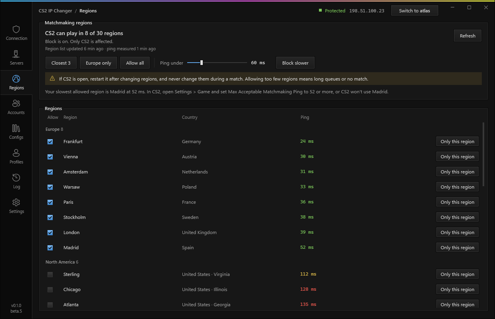
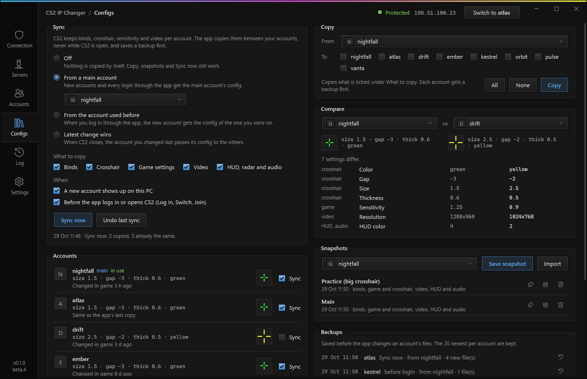
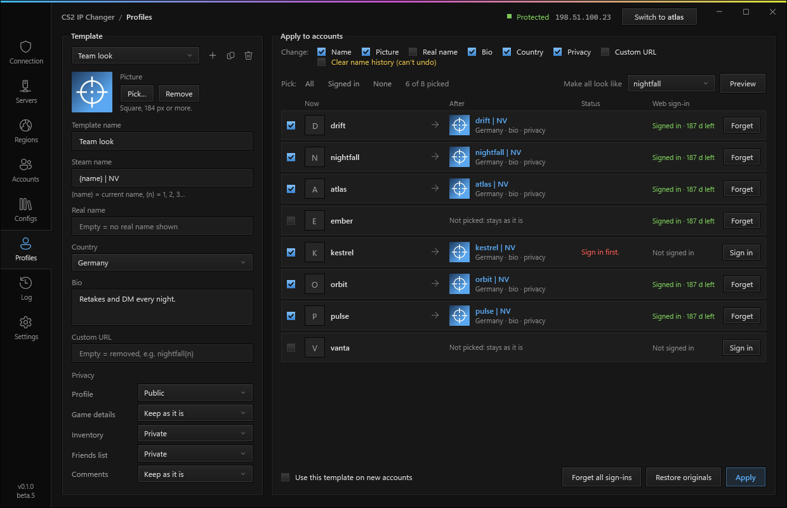

<h1 align="center">
  
</h1>

<p align="center">
  <a href="https://github.com/Sepd0x/cs2-ip-changer/releases"></a>
  
  <a href="#telemetry"></a>
  <a href="https://github.com/Sepd0x/cs2-ip-changer/attestations"></a>
  <a href="https://sepd0x.github.io/cs2-ip-changer/"></a>
</p>

<p align="center">
  <a href="https://github.com/Sepd0x/cs2-ip-changer/releases"></a>
</p>

<p align="center">
  <sub>Admin is needed for the routes and firewall rules. It never touches the game process, its memory or its program files. No account. Anonymous usage stats while in beta (<a href="#telemetry">what is sent</a>). <a href="#check-your-download">Check your download</a>.</sub>
</p>

<p align="center">
  <a href="https://sepd0x.github.io/cs2-ip-changer/">Website</a>
  &nbsp;·&nbsp;
  <a href="#how-it-works">How it works</a>
  &nbsp;·&nbsp;
  <a href="#what-it-does">Features</a>
  &nbsp;·&nbsp;
  <a href="#setup">Setup</a>
  &nbsp;·&nbsp;
  <a href="#faq">FAQ</a>
  &nbsp;·&nbsp;
  <a href="#if-something-goes-wrong">Troubleshooting</a>
  &nbsp;·&nbsp;
  <a href="CHANGELOG.md">Changelog</a>
</p>

**CS2 IP ban bypass and home IP protection for Counter-Strike 2 community servers, free for Windows.**

CS2 IP Changer sends CS2 and Steam through your Android phone's mobile data, so community servers see your carrier's IP and not your home IP. If you get IP banned, change the IP from the app and join again. There's a Steam account switcher for your alt accounts in it too, plus a CS2 config manager, a Steam profile editor and a matchmaking region picker.

It isn't a VPN: servers see a normal mobile connection from your carrier, so it also works on community servers that block VPNs and datacenter IPs. Your home IP stays out of the server's logs, out of reach of anyone on the server who wants to DDoS or dox you, and off screen when you stream.

> [!WARNING]
> This is a beta, so expect bugs. If something breaks your connection, **Settings > Turn off protection** removes the routes and firewall rules of the protection (`CS2IPChanger.exe --restore` removes the region block too).

> [!NOTE]
> Playing over mobile data usually means higher ping, more jitter and the odd lost packet compared to your home connection, so the game can feel laggier. How much depends on your carrier, the signal where the phone sits and how busy the cell is. In Game only mode the rest of your PC stays on your home connection. The app measures the phone connection every 30 seconds and tells you when it's weak (see [Connection quality](#what-it-does)).

<p align="center">
  
</p>

## Who it's for

- You got IP banned on a community server and want back in.
- You play on community servers and would rather keep your home IP out of their logs and ban lists.
- You switch between alt accounts a lot, or you stream and want your home IP and Steam logins off screen.
- You play on several accounts and want the same binds, crosshair and settings on all of them.
- You want CS2 matchmaking to put you only in the regions with the lowest ping.

## How it works

<picture>
  <source media="(prefers-color-scheme: dark)" srcset="docs/assets/how-it-works-dark.svg">
  
</picture>

The phone shares its mobile data with the PC over USB tethering (or its hotspot). The app routes CS2, Steam and your servers through it and blocks them on your home connection, so those servers only see the carrier's IP.

### CS2 IP Changer or a VPN?

| | CS2 IP Changer | VPN or proxy |
|---|---|---|
| IP the server sees | Your carrier's mobile IP, like any player on a phone hotspot | An IP from the VPN's datacenter |
| Servers that block VPNs and datacenter IPs | Works: it's an ordinary mobile connection | Often blocked |
| Getting a new IP | One click: mobile data off and on over ADB | Connect to another VPN server |
| Cost | Free, uses your phone's data plan | Usually a subscription |
| What goes through it | CS2, Steam and your servers, or the whole PC if you pick it | Usually the whole PC |
| If the connection drops | Windows Firewall kill switch: CS2 loses the connection instead of using your home IP | Depends on the VPN app |

## What it does

| Feature | Details |
|---|---|
| Game-only routing | CS2, Steam and the servers on your list go through the phone. Your browser, Discord and downloads stay on your home connection and don't eat your mobile data. You can send the whole PC through the phone instead: IPv4 and DNS go through the phone, and IPv6 is blocked while it's on, so nothing leaves from home. |
| No phone mode | No phone with you? Pick "No phone: play on your home connection" under What goes through the phone. Nothing is blocked and servers see your home IP, and the app says so in plain words. Accounts, Configs, Profiles and Regions keep working. |
| Kill switch | A Windows Firewall rule blocks your listed servers on every adapter except the phone, and `cs2.exe`'s game traffic (UDP) can only use the phone connection. If the cable comes out, the game loses connection instead of falling back to your home IP. |
| Change IP | Turns mobile data (or airplane mode) off and on over ADB until the carrier hands you a new IP. Old IPs stay in a list so you can see they really changed. |
| Change IP and rejoin | When a server kicks or bans you, the app plays a sound and offers to get a new IP and join the last server again (only once protection is confirmed). After a ban it also logs into the next account that server hasn't banned, because the ban is on the IP and the account. <kbd>Ctrl</kbd>+<kbd>Shift</kbd>+<kbd>F10</kbd> does it from inside the game (you can pick another key in Settings > Switch). When Steam or VAC refuses the account instead, the app says so and doesn't offer a new IP, because it wouldn't help. |
| Connection quality | Every 30 seconds the app pings through the phone and shows ping, jitter and loss in Checks: Good, Fair or Weak. Weak means 150 ms or more, jitter of 40 ms or more, 2 of 8 pings lost, or a 3G/2G network, two measurements in a row. When it's weak the app warns you, and if Whole PC is on it drops to Game only so CS2 doesn't share the phone with your browser, Discord and downloads. It goes back to Whole PC once the connection is fine again and CS2 is closed, never mid-match. You can turn that off in Settings > Protection. |
| New range check | Tells you if the new IP is in a new /16 or the same one as before, because some admins ban the whole range. It can keep trying until the range changes. |
| Live checks | Firewall, routes, the IP servers see next to your home IP, whether the phone is really on mobile data, and whether Steam uses the same connection as the game (otherwise servers kick you with "No Steam logon"). There's a leak test too. |
| Server list | Paste `IP:port`, `connect IP:port` or `steam://connect/...` links. You see name, map, players and ping, and join with one click. On a full server the app can wait for a slot and join when one opens. |
| Regions | Pick where CS2 matchmaking (Premier, Competitive, Casual, Deathmatch, Wingman) can put you. Each region shows its ping through the phone (your home connection in No phone mode), and you turn regions on or off, or use Only this region, Closest 3, your continent only (Europe only, North America only…, from your lowest ping or your home country), Allow all or Ping under X ms. Turned-off regions are blocked with one Windows Firewall rule for `cs2.exe` only, on Valve's relay IPs only: Steam, friends and community servers aren't touched. The relay list comes from Valve and is saved for when you're offline, and the rule is rebuilt when Valve changes the list. Changes apply at once; CS2 re-measures the regions on its next start. Regions don't depend on the phone or on protection: they stay off until you click Allow all. Blocking too much means long queues or no match. |
| Players | Click the player count to see who is on a server. Some communities hide the list, and the app shows "hidden" there. |
| Player flags | Flag a player as Staff or with your own label and color, by name or by Steam profile link so the flag follows name changes. Servers only share names, so a flag without a profile matches anyone with that name. |
| Follow a player | You get a sound and a notice with Join when a player you follow shows up on another server in your list. Joining them automatically is off by default and always asks while CS2 is open. |
| Server bans | When CS2's console shows a ban, the account in use gets marked for that server and for the rest of the same community (the same tag in the name, or a community name you set with right-click > Set community name). Generic names like "Retakes" or "Mirage 24/7" don't count, and neither does a shared IP on its own. Joining there with it asks first. |
| Account switcher | Switches between the Steam accounts saved on your PC without typing passwords. Switch (top bar, Accounts or <kbd>Ctrl</kbd>+<kbd>Shift</kbd>+<kbd>F9</kbd>, even mid-game) gets a new IP, logs into the next account and joins the last server again; in Settings you pick which of those steps it does. Each account shows VAC, game and trade bans and its cooldown, and Switch skips accounts on cooldown or with a ban mark on that server. CS2 only opens once Steam is really on the new account; if Steam logs in to another one, the app tells you. |
| CS2 config manager | The Configs page copies your CS2 config between your accounts: binds, crosshair, the other game settings (sensitivity, viewmodel), video, and HUD, radar and audio, each on its own. Pick a sync mode: from a main account, from the account you used before, or latest change wins. It runs when a new account shows up, before the app logs in or opens CS2, or when you click Sync now. Nothing is written while CS2 is open, every change keeps a backup (Undo last sync puts it back), and an account can be left out. Save a config as a named snapshot, export it as a .zip for another PC, and compare two accounts setting by setting with a crosshair preview. See [CS2 config manager](#cs2-config-manager). |
| Profiles | Changes the name, picture, real name, bio, country, privacy and custom URL of the accounts you pick, from saved templates, or makes them all look like one account in one click. You see each account now and after before anything is sent, a copy of each profile is kept so Restore original puts it back, and new accounts can get a template on their own. `{name}` and `{n}` work in names; a login never ends up on a profile. Needs a one-time Steam sign-in per account ([what happens to your login](#profiles)). |
| Clear feedback | Every command plays a short sound when it's taken and another when it's done or failed, and the top bar shows what it's doing. You hear it in game too. The sounds can be turned off. |
| Open with CS2 | Programs you pick, like Discord, Spotify or a stats tracker, open when the app opens CS2. They start as you, never with the app's admin rights. A program that needs admin gets an As admin switch: Windows asks first (UAC). |
| Stream friendly | Hide usernames keeps usernames off screen, also in the Log, and your home IP stays masked in the app. The Steam Web API key is hidden unless you click Show. |
| Updates | Once a day at most it checks for a new version and only installs it if the SHA-256 from the release matches. Before downloading it tells you the size, and warns you when the download would go through the phone's mobile data. You can turn this off. |

<table>
  <tr>
    <td width="50%"></td>
    <td width="50%"></td>
  </tr>
  <tr>
    <td align="center">Servers</td>
    <td align="center">Accounts</td>
  </tr>
  <tr>
    <td width="50%"></td>
    <td width="50%"></td>
  </tr>
  <tr>
    <td align="center">Regions</td>
    <td align="center">Configs</td>
  </tr>
</table>

### CS2 config manager

CS2 keeps each account's settings in `Steam\userdata\<id>\730\local\cfg`: binds in `cs2_user_keys_0_slot0.vcfg`, the crosshair and game settings in `cs2_user_convars_0_slot0.vcfg`, video in `cs2_video.txt`, and HUD, radar and audio in `cs2_machine_convars.vcfg`. The Configs page copies those files between your accounts.

- **Sync modes.** Off (the default), From a main account, From the previous account, or From the account changed last (when CS2 closes, the account you changed last copies its config to the others). Right-click an account > Use as main config is the quick way in.
- **When.** When a new account shows up on the PC, and right before the app logs in (Log in, Switch) or opens CS2 for a join. Sync now does it by hand. Turn Sync off on an account and the sync never touches it.
- **Video stays this PC's.** Copying Video copies the resolution and the graphics settings, but each account keeps this PC's refresh rate and monitor, so a 144 Hz screen doesn't end up at 60 Hz.
- **Crosshair only.** Crosshair and Game settings are separate: you can copy just the crosshair and keep each account's sensitivity, or the other way round.
- **Never with CS2 open.** CS2 saves its config when it closes and would undo the copy, so the copy waits and goes in when CS2 closes.
- **Steam Cloud.** Binds and game settings are also kept in Steam Cloud. The app writes the cloud copy too, the same way CS2 does when it saves, so Steam uploads the new one on the next launch. If an account was played on another PC since, Steam may bring that version back, or ask which one to keep. If your settings keep going back, turn off Steam Cloud for CS2 (CS2 > Properties > General).
- **Backups.** Before it changes an account, the app saves that account's files in `SRT_Dados\configs\backups` (the 20 newest per account). Undo last sync puts back everything the last sync changed, and any backup can be restored on its own.
- **Snapshots.** Save an account's config under a name, copy it to any accounts later, or export it as a `.zip` to use on another PC. The `.zip` has only the config files and the name, never the account. Video settings from a PC with another graphics card may be redetected by CS2.
- **Compare.** Pick two accounts or snapshots to see the settings that differ, in words where the app knows them (sensitivity, crosshair, resolution, viewmodel, binds), and a preview of each crosshair.

Nothing from your configs goes into Save bug report.

### Profiles

<p align="center">
  
</p>

The Profiles page changes how your Steam accounts look to others. Make a template (name, picture, real name, bio, country, privacy, custom URL), pick the accounts, check the preview and click Apply. The accounts are changed one after another with a pause between them, and each result is shown next to the account in plain words. What you can do with it:

- **Preview**: pick an account under "Make all look like" and every other account gets its name, picture, real name, bio and country. Right-click an account on Accounts > Copy look to… does the same.
- **Names with numbers**: `nightfall {n}` gives nightfall 1, nightfall 2… in the order of the list. `{name}` is the account's name now, so `{name} | NV` adds a tag. There is no `{login}`, on purpose: a login on a public profile is half of what someone needs to take the account. The app also refuses a name, bio or URL that would show any login saved on your PC.
- **Copy from an account** (the copy button next to the template) reads that account's look into the template. **From a Steam profile link** in the same menu takes any profile (`steamcommunity.com/id/…`, `/profiles/…` or a SteamID64), like an account you have on another PC: its public name, picture, real name, bio and country. What that profile keeps private stays as it is on each account.
- **Undo**: before the first change on an account, the app keeps a copy of its profile (name, details, privacy and picture) in `SRT_Dados/profiles/snapshots`, the original and the 5 newest per account. Right-click > Restore original puts it back; Undo the last change goes back one step.
- **New accounts**: tick "Use this template on new accounts" and an account that shows up later in Steam is offered that look (the app asks you to sign in to it once).
- **Clear name history** also empties "previously known as". That one is permanent: Steam has no way back, and Restore can't bring them back either. It's off unless you tick it.

Pictures are cropped square and saved again as a new JPG before they're used, so nothing from the original file (photo data like EXIF or GPS) reaches Steam.

**What it keeps on your PC.** All of it is in `SRT_Dados/profiles`: your templates (`templates.json`) and their pictures (`avatars`), the copies for undo (`snapshots`, one folder per account), the encrypted sign-ins (`sessions`) and the list of accounts it has already seen, so it knows when a new one shows up (`known.json`). Nothing of it leaves your PC except what you apply to Steam.

**What happens to my login.** Changing a profile needs a Steam web session for that account, the same one your browser has on steamcommunity.com. When you click Sign in, the app signs in the way Steam's own login page does: you type the password (or scan a QR code with the Steam app and type nothing) and approve Steam Guard. The password goes straight from the box into Steam's encryption key for that sign-in and is wiped from memory right after. It is never saved, never written to the Log and never sent anywhere but Steam. What the app keeps is Steam's sign-in token for that account, encrypted with Windows (DPAPI: only your Windows user can open it) in `SRT_Dados/profiles/sessions`, one file per account that only your Windows user can read. It's never in the Log, in Save bug report or in the usage stats. Steam lists the sign-in under Steam > Settings > Security > Authorized devices as "CS2 IP Changer", where you can end it at any time, and Forget (per account) or Forget all sign-ins deletes the files. For this the app only talks to Steam (steamcommunity.com, login.steampowered.com, api.steampowered.com and Steam's picture servers), over HTTPS. Signing in is off in the recording build, and the Profiles page there hides names and pictures like the Accounts page.

## Setup

You need Windows 10 or 11 (64-bit), admin rights and an Android phone with mobile data.

1. Download `CS2IPChanger.exe` from [Releases](https://github.com/Sepd0x/cs2-ip-changer/releases) and put it in a folder only admins can change, like `C:\Program Files\CS2 IP Changer`. It runs as admin, so Downloads is a bad place for it. Already used it from another folder? Close it and copy `CS2IPChanger.exe` together with its `SRT_Dados` folder there: copying, not moving, gives the folder the new place's permissions.
2. Plug the phone in by USB, turn on USB tethering and turn off the phone's Wi-Fi, so it shares mobile data and not your home Wi-Fi. While the phone's Wi-Fi is on, the app keeps your servers and CS2 blocked. Not sure what's missing? Press **Phone setup** under Phone: it checks the cable, the USB driver, USB debugging, tethering, the phone's Wi-Fi and where the rest of the PC goes, does each step it can and tells you the one thing left.
3. Run the app (it needs admin) and paste the servers you play on into **Servers**.
4. Open **Connection**. With CS2 and Steam running, every check should be green, and the IP servers see must not be your home IP.

Windows Firewall has to be on. Third-party firewalls that turn it off (some antivirus suites) leave the app without a kill switch, and it says so.

The exe isn't code-signed, so Windows SmartScreen may warn you the first time you run it. Click More info > Run anyway, or [check your download](#check-your-download) first.

To change IP from the PC, also turn on USB debugging on the phone. If ADB isn't installed, the app can download Google's platform-tools for you (about 7 MB).

To spot kicks and bans, CS2 needs the `-condebug -conclearlog` launch options (the second one starts `console.log` fresh each time, so it doesn't grow forever). The app adds both when it opens CS2, and tells you if they're missing when you start the game from Steam.

The hotkeys are <kbd>Ctrl</kbd>+<kbd>Shift</kbd>+<kbd>F9</kbd> for Switch and <kbd>Ctrl</kbd>+<kbd>Shift</kbd>+<kbd>F10</kbd> for Change IP and rejoin. Change them in Settings > Switch. The app won't take Ctrl+Alt combinations: on many keyboards that's AltGr, which types @ and €.

The app is portable. Settings, servers and accounts are saved in `SRT_Dados` next to the exe. To uninstall, run `CS2IPChanger.exe --restore` first (it removes the region block too) and then delete the folder, and also `C:\ProgramData\CS2IPChanger` (the Windows files the exe unpacks there; the app removes older versions' folders by itself).

### Check your download

Releases built by GitHub Actions come with a `CS2IPChanger.exe.sha256` file and a build attestation, which shows the exe was built from this repository's code. To check the attestation, install the [GitHub CLI](https://cli.github.com/), sign in once with `gh auth login` and run:

```powershell
gh attestation verify CS2IPChanger.exe -R Sepd0x/cs2-ip-changer
```

To check only the hash, put the `.sha256` file next to the exe and run this in PowerShell. It prints `True` if they match:

```powershell
(Get-FileHash .\CS2IPChanger.exe).Hash -eq (Get-Content .\CS2IPChanger.exe.sha256).Split()[0]
```

## If something goes wrong

The firewall rules stay in place when you close the app, on purpose, so your IP can't leak while it's closed. To undo everything:

- In the app: Settings > Turn off protection. It removes the routes and rules and checks that they're really gone. Protection stays off until you press Run leak test or open the app again. Regions you turned off stay off: Allow all on Regions lifts them.
- If the window won't open: run `CS2IPChanger.exe --restore`. It removes everything, the region block too.
- If you already deleted the app: open [tools/restore.cmd](tools/restore.cmd), click Download raw file, right-click the file and pick Run as administrator, then restart the PC.

Lag, or programs opened with CS2 losing their connection? Look at Connection quality in Checks. If it says Weak, the phone connection is the problem: see [Will my ping be worse?](#faq). In Whole PC mode, programs opened with CS2 go through the phone too, so a new IP cuts their connections: use Game only for them.

Found a bug? [Open an issue](https://github.com/Sepd0x/cs2-ip-changer/issues/new/choose) with the version (bottom left of the window) and the diagnostics (Log page > Save bug report). That saves a .zip on your Desktop with the log, the app's rules and routes, Steam's connection log and CS2's console. Your home IP and API key are left out, but look through it before you post. If you paste the log instead (Copy all), blank out your IPs first.

## FAQ

<details>
<summary><b>Is it a VPN? Does it work on servers that block VPNs?</b></summary>
<br>

No, it isn't a VPN, and yes, it works there. A VPN sends your traffic through a datacenter, and many community servers block datacenter and VPN IP ranges. This app sends CS2 and Steam through your own phone's mobile data, so the server sees an ordinary mobile connection from your carrier, the same as someone playing on a phone hotspot. There's no VPN server in between and no subscription.
</details>

<details>
<summary><b>Does the account switcher store my Steam password?</b></summary>
<br>

No. It uses the logins Steam already saved on your PC (the accounts where you ticked Remember me). To switch, it tells Steam which saved account to log into and restarts Steam, the same way other Steam account switchers work. Switching never asks for your password or your Steam Guard codes.

The only place you type a password is Sign in on the Profiles page, and only if you want the app to change a profile. Even there it's used once and never saved: the app keeps an encrypted Steam sign-in token instead ([what happens to your login](#profiles)). You can also sign in with a QR code from the Steam app and type nothing.
</details>

<details>
<summary><b>Why does it need admin?</b></summary>
<br>

Routes and firewall rules are system settings, and Windows only lets admins change them. That's also why the exe should live in a folder only admins can change.
</details>

<details>
<summary><b>Can this get me VAC banned?</b></summary>
<br>

It never touches the game process, its memory or its program files. It changes Windows routing and firewall rules and which Steam account logs in. If you use them, the Configs page copies CS2's config files (binds, crosshair, video and so on) between your accounts, the same files CS2 writes when you change a setting, and the Profiles page changes your Steam profiles. It also won't hide a cheat from VAC or any other anti-cheat, so don't use it for that.
</details>

<details>
<summary><b>Does forcing a region get me banned?</b></summary>
<br>

The Regions page doesn't touch the game, its files or its memory. It adds one outbound Windows Firewall rule that stops `cs2.exe` from reaching Valve's relays in the regions you turned off, so CS2 sees those regions as unreachable and matchmaking plays elsewhere. To the game it looks the same as a bad connection to those relays. Still, we can't speak for Valve and can't promise anything about how they treat it. Allow all removes the rule, and so does `--restore`. Turn off protection and No phone mode leave it on.
</details>

<details>
<summary><b>I'm banned on a server. Will this get me back in?</b></summary>
<br>

If it's an IP ban, change IP and join again. A ban on your Steam account follows the account, not the IP, so a new IP won't lift it, and your other accounts aren't affected by it. The app marks that account as banned on that server and its network, and Switch won't pick it there.
</details>

<details>
<summary><b>Some admins ban a whole IP range. Does that matter?</b></summary>
<br>

After each change the app tells you whether the new IP is in a new /16 or in the same one as before. If you want it to keep going until the range changes, turn on Settings > Keep changing until the IP is in a new range.
</details>

<details>
<summary><b>Does it stop me from getting banned?</b></summary>
<br>

No app can stop an admin from banning you. What it does is keep your home IP out of every server's ban list, so a ban never sticks to your house and getting back in takes a few seconds.
</details>

<details>
<summary><b>Why bother hiding my home IP?</b></summary>
<br>

Anyone running a community server can see the IP of every player who joins, and IP bans are tied to it. With the phone's IP, nobody gets your home connection to DDoS it, and after a ban you change IP and keep playing on the same servers.
</details>

<details>
<summary><b>My carrier uses CGNAT. Is that a problem?</b></summary>
<br>

No. You share a public IP with other customers and servers see that shared one. Change IP still works, but sometimes the carrier gives you the same IP back, so the app keeps trying (you set how many times).
</details>

<details>
<summary><b>Will my ping be worse?</b></summary>
<br>

Usually, yes. Mobile data adds latency and jitter, and some cells drop packets when they're busy, so expect a higher ping than at home and a game that can feel less smooth. A good 5G or 4G signal helps a lot: put the phone near a window, keep it charging and don't run other heavy stuff on it. The ping column in Servers is measured through the phone, so it shows what you'll get before you join, and Connection quality in Checks tells you when the connection itself is weak.

If it stays weak: Change IP can put you on another cell, and Game only keeps the rest of the PC off the phone (the app does this on its own while the connection is weak, unless you turn it off). On the phone you can also check Settings > Connections > Mobile networks > Network mode is set to include 5G. Forcing 5G only helps where the 5G signal is good, and some phones show 5G as 4G (LTE) because 5G there runs on top of 4G.
</details>

<details>
<summary><b>Can I use the phone's Wi-Fi hotspot instead of a cable?</b></summary>
<br>

Yes. Connect the PC to the hotspot and pick it under Connection > How the PC connects to the phone. The app remembers the network name, and if Windows jumps back to your home router it blocks everything. Change IP works on the hotspot too if the phone is also plugged in by USB with USB debugging on (the cable is only for ADB, tethering can stay off).
</details>

<details>
<summary><b>What about a 4G/5G USB dongle or router?</b></summary>
<br>

It works as the connection. If the app doesn't pick it on its own, choose it under Connection > How the PC connects to the phone: USB network adapters that aren't phones (like a laptop dock's Ethernet) are only used when you pick them. Change IP needs an Android phone with ADB, though.
</details>

<details>
<summary><b>In Whole PC mode, websites take a second to open. Why?</b></summary>
<br>

While Whole PC is on, DNS can only leave through the phone and IPv6 is blocked, so nothing goes out from home. Windows may first try your home router's DNS or an IPv6 address, get blocked, and then use the phone. That can add a second or two to the first visit to a site. Game only mode doesn't do this.
</details>

<details>
<summary><b>Why does the app want <code>-condebug -conclearlog</code>?</b></summary>
<br>

`-condebug` makes CS2 write its console to `console.log`, which is how the app sees a kick or a ban. `-conclearlog` empties that file each time CS2 starts, so it doesn't grow forever. The app adds both when it opens CS2. If you start CS2 from Steam, add them to the launch options (CS2 > Properties).
</details>

<details>
<summary><b>What happens when I close the app?</b></summary>
<br>

Protection stays on, so closing the app can't leak your IP. If you'd rather have it turn off, there's a setting for that.
</details>

## Privacy

There's no account. While the app is in beta it sends anonymous usage stats ([Telemetry](#telemetry)). Besides that, it only talks to these services:

| What for | Service |
|---|---|
| Your public IP (home and phone) | api.ipify.org, ipv4.icanhazip.com, checkip.amazonaws.com, 1.0.0.1 (Cloudflare) |
| Carrier and city of an IP | ipwho.is (over HTTPS) |
| Profiles, avatars and bans of your accounts, and the public profile of a link you paste in Profiles | steamcommunity.com, Steam's avatar servers and, if you add a key, api.steampowered.com |
| Regions: Valve's relay list (at every start, and every hour while regions are off) | api.steampowered.com (`GetSDRConfig`, no key), plus pings to Valve's relays through the phone (your home connection in No phone mode) |
| Changing your profiles (only accounts you sign in to on the Profiles page) | steamcommunity.com, login.steampowered.com, api.steampowered.com and Steam's avatar servers |
| Downloading ADB (only if you ask) | dl.google.com |
| Checking for updates (can be turned off) | api.github.com, github.com |
| Anonymous usage stats (beta, [Telemetry](#telemetry)) | the project's Cloudflare Worker (source in [`worker/stats`](worker/stats)) |

Your Steam Web API key stays on your PC, in `SRT_Dados/settings.json`. The Profiles sign-ins stay on your PC too, encrypted, in `SRT_Dados/profiles/sessions`.

The app measures the phone's IP by asking 1.0.0.1 (Cloudflare's `/cdn-cgi/trace`). A firewall rule keeps the app's own requests to it on the phone connection, and leaves other programs alone. Windows routes can't be set per program, though: while the phone is connected, anything on your PC that talks to 1.0.0.1 (for example, if you use it as your DNS server) goes through the phone too.

## Telemetry

While CS2 IP Changer is in beta, it sends anonymous usage stats so bugs can be found and the parts people use get better. It's always on in the beta. If you don't want that, don't use the beta.

Once when the app has been open for 20 seconds, and then once a day, it sends:

- a random ID made on your PC the first time (not tied to you, your PC, Steam or anything else; it only lets the same install be counted once a day)
- the app version and the Windows version
- the mode (Game only, Whole PC while CS2 is open, Whole PC always, No phone) and how the phone is connected (USB, hotspot)
- minutes the app was open
- how many times each button and hotkey was used, counted by the name of its code (for example `ChangeIp_Click`), never by what's on it
- a few counters: IP changes that worked, that got the same IP or no network, kicks and bans the app saw, errors in the Log, and where Phone setup stopped (the step's name, like `phone_setup_tetheroff`)
- how many servers, accounts, flagged players and "Open with CS2" programs are in your lists, and how many regions are turned off (the number only)
- errors as their type and place in the app's code (for example `NullReferenceException` in `MainWindow.QueryServers`), never their message

It never sends IPs (yours, the phone's or servers'), server names or addresses, Steam accounts, logins, names or IDs, your carrier or city, players' names, file paths or anything you typed.

The server is a Cloudflare Worker whose code is in this repo ([`worker/stats`](worker/stats)). Cloudflare has to see your IP to deliver the request, like with any website, but the Worker never reads it or stores it, and its request logs are off. The stats are stored per day in a database with no IP column ([`schema.sql`](worker/stats/schema.sql)). The recording build sends nothing.

## License

All rights reserved. You can download the releases and use them. You can't copy, modify or redistribute the code without permission. Details in [LICENSE](LICENSE).

The command sounds are from [Interface Sounds](https://kenney.nl/assets/interface-sounds) by Kenney (CC0).

Not affiliated with Valve. Counter-Strike and Steam are trademarks of Valve Corporation.

<sub>Keywords: CS2 IP changer, CS2 IP ban bypass, Counter-Strike 2 IP ban, change IP in CS2, CS2 IP unban on community servers, hide IP in CS2, protect your home IP from DDoS, play CS2 on mobile data, USB tethering for gaming, CS2 kill switch, Steam account switcher, CS2 alt accounts, CS2 config sync between accounts, Steam profile changer, CS2 region selector, CS2 matchmaking region blocker, CS2 server list with ping.</sub>
