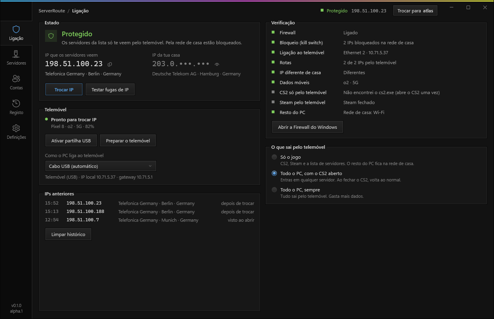
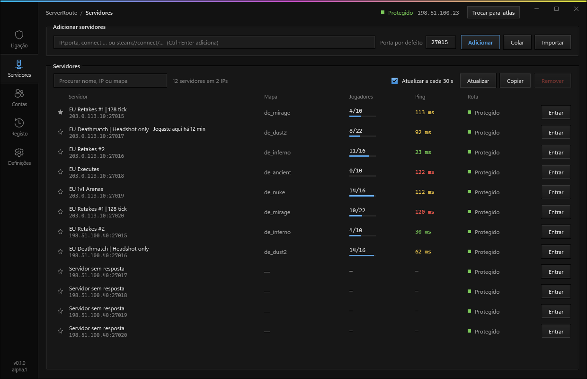
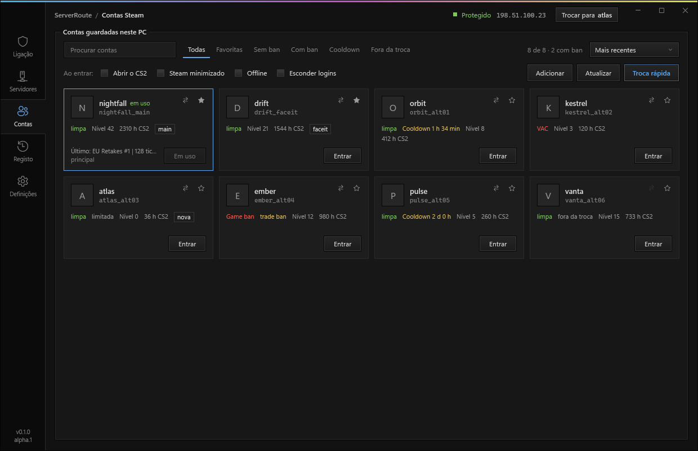

# ServerRouteTool

**IP ban bypass e proteção do IP de casa para servidores comunitários do CS2.** O jogo e o Steam saem pelos dados móveis de um telemóvel ligado por USB: os servidores veem o IP da operadora, nunca o teu. Levaste ban por IP? Trocas de IP com um clique e voltas a entrar. Inclui troca de contas Steam com bans e cooldowns à vista.

> **Versão alpha.** Funciona, mas ainda pode ter erros. Se algo correr mal, **Definições > Restaurar rede** desfaz as rotas e as regras da Firewall.

## Para que serve

- **Ban por IP num servidor comunitário:** troca de IP pelos dados móveis e entra outra vez.
- **Esconder o IP de casa:** os donos dos servidores, os admins e os outros jogadores não chegam ao IP da tua casa (DDoS, doxx).
- **Várias contas Steam:** troca de conta sem escrever a password, com bans (VAC, game ban, trade ban) e cooldowns de cada uma.
- **Jogar pela rede móvel sem mandar o PC todo:** só o CS2 e o Steam passam pelo telemóvel; o resto fica na rede de casa e não gasta dados.

## O que faz

- **Só o jogo pelo telemóvel.** Os servidores da tua lista, o CS2 e o Steam saem pelo telemóvel; o resto do PC (browser, Discord, downloads) continua na rede de casa. Também há "Tudo, com o CS2 aberto" e "Tudo, sempre".
- **Kill switch.** Uma regra da Firewall do Windows bloqueia os servidores da lista em todas as placas menos no telemóvel. Se o cabo cair, o jogo fica sem rede em vez de mostrar o IP de casa.
- **CS2 trancado ao telemóvel.** O `cs2.exe` só tem rede pelo telemóvel, também para servidores fora da lista (browser do jogo, convites).
- **Verificação ao vivo.** Firewall, kill switch, rotas confirmadas pelo próprio Windows, IP diferente do de casa, o telemóvel nos dados móveis (e não no Wi-Fi de casa) e o Steam na mesma saída que o jogo (evita o kick "No Steam logon").
- **Trocar IP.** Desliga e liga os dados móveis (ou o modo avião) por ADB até vir um IP novo. Há também um teste de fugas.
- **Servidores.** Cola `IP:porta`, `connect …` ou `steam://connect/…`; a app mostra nome, mapa, jogadores e ping, e entra com um clique.
- **Contas Steam.** Troca rápida com Ctrl+Alt+Q (também dentro do jogo), bans lidos do perfil público ou da Steam Web API, cooldowns com contagem decrescente, favoritas e etiquetas.

## Requisitos

- Windows 10 ou 11, 64 bits.
- Permissões de administrador (a app mexe em rotas e na Firewall do Windows).
- Um telemóvel Android ligado ao PC por **Tethering USB** (Definições > Ligações > Hotspot e tethering), ou o PC ligado ao **ponto de acesso Wi-Fi** do telemóvel. Uma pen ou router 4G/5G por USB também serve.
- Opcional: **depuração USB** ligada no telemóvel, para trocar de IP a partir do PC. Se não encontrar o ADB, a app oferece-se para descarregar as platform-tools oficiais da Google.

## Como usar

1. Descarrega o `ServerRouteTool.exe` da [última versão](../../releases) e põe-no numa pasta só dele.
2. Liga o telemóvel por USB, liga o Tethering USB e desliga o Wi-Fi do telemóvel (assim partilha os dados móveis, não o Wi-Fi de casa).
3. Abre a app (pede administrador). Em **Servidores**, cola os servidores onde jogas.
4. Em **Ligação**, confirma que está tudo a verde e que o IP que os servidores veem é diferente do de casa.

Preferes o ponto de acesso Wi-Fi? Liga o Wi-Fi do PC à rede do telemóvel e escolhe-a em **Ligação > Como o PC liga ao telemóvel**. A app guarda o nome dessa rede: se o PC saltar para o router de casa, bloqueia tudo.

A app é portátil: as definições, a lista de servidores e as contas ficam em `SRT_Dados`, ao lado do `.exe`. Para a tirar, carrega primeiro em **Restaurar rede** e depois apaga a pasta.

## Bom saber

- Com CGNAT, o IP da operadora é partilhado com outros clientes. Os servidores veem esse IP, não o teu.
- A app não mexe no jogo nem em ficheiros do CS2: só em rotas, regras da Firewall e na escolha da conta no Steam. Não é um cheat e não toca no VAC.
- Um ban por IP é diferente de um ban à conta: se o servidor baniu a conta Steam, trocar de IP não chega.
- Por defeito, a proteção continua com a app fechada. Se preferires o contrário, liga **Desfazer tudo ao fechar a app**.

### Privacidade

A app não tem telemetria. Fala só com estes serviços:

| Para quê | Serviço |
|---|---|
| Saber o IP público (de casa e do telemóvel) | api.ipify.org, ipv4.icanhazip.com, checkip.amazonaws.com, 1.0.0.1 (Cloudflare) |
| Operadora e cidade de um IP | ip-api.com |
| Perfis, avatares e bans das contas | steamcommunity.com, os servidores de avatares do Steam e, se puseres uma chave, api.steampowered.com |
| Descarregar o ADB (só se pedires) | dl.google.com |

A chave da Steam Web API fica só no teu PC, em `SRT_Dados/settings.json`.

## In English

**CS2 IP ban bypass and home IP protection for community servers.** ServerRouteTool routes CS2 and Steam through an Android phone's mobile data (USB tethering or Wi-Fi hotspot), so community servers only ever see your carrier's IP, never your home IP. Got IP banned? Change your IP in one click and rejoin. A Windows Firewall kill switch blocks the listed servers on every other adapter, so a dropped cable means no connection instead of a leak. It also works as a Steam account switcher with VAC, game ban and trade ban status and cooldown timers. No cheats, no game file changes. Windows 10/11 x64, admin rights; the interface is in Portuguese.

## Licença

Todos os direitos reservados. Podes descarregar e usar a app; não podes copiar, alterar nem redistribuir o código sem autorização. Detalhes em [LICENSE](LICENSE).

Projeto independente, sem ligação à Valve. Counter-Strike e Steam são marcas da Valve Corporation.
