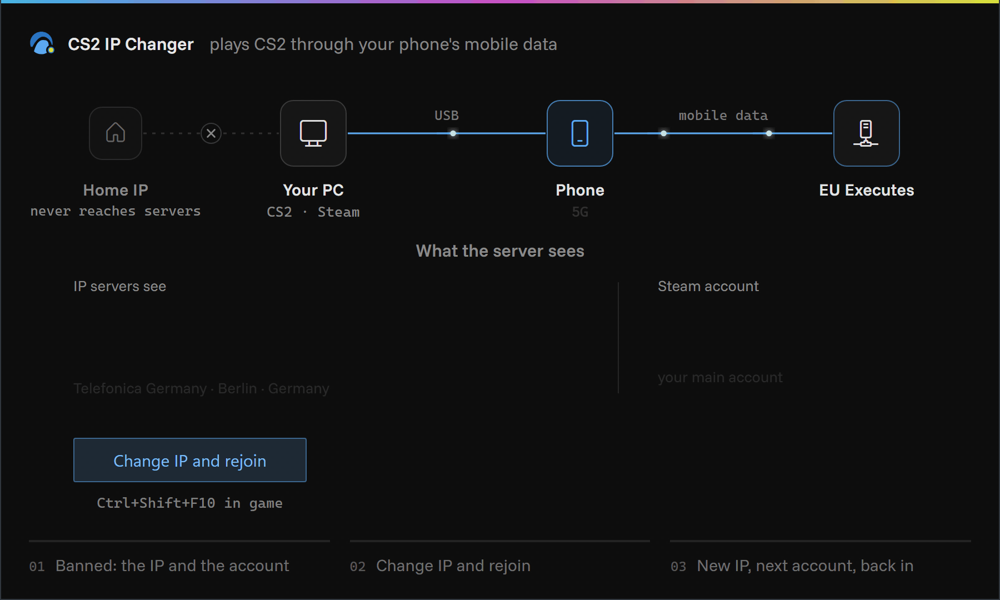

<p align="center">
  
</p>

<h1 align="center">CS2 IP Changer</h1>

<p align="center">
  <b>CS2 IP ban bypass and home IP protection for Counter-Strike 2 community servers. Free, for Windows.</b>
</p>

<p align="center">
  <a href="https://github.com/Sepd0x/cs2-ip-changer/releases/latest/download/CS2IPChanger.exe">
    <picture>
      <source media="(prefers-color-scheme: dark)" srcset="docs/assets/download-button-dark.svg">
      
    </picture>
  </a>
  <br>
  <sub><!--rel:line--><a href="https://github.com/Sepd0x/cs2-ip-changer/releases/latest/download/CS2IPChanger.exe">CS2IPChanger.exe</a> · v0.1.0-beta.10 · 63.4 MB · 4 Nov 2026 · <a href="https://github.com/Sepd0x/cs2-ip-changer/releases/latest">release notes and checksums</a><!--/rel--></sub>
</p>

<p align="center">
  <a href="https://github.com/Sepd0x/cs2-ip-changer/releases"></a>
  
  <a href="https://github.com/Sepd0x/cs2-ip-changer/attestations"></a>
</p>

<p align="center">
  <a href="https://sepd0x.github.io/cs2-ip-changer/">Website</a>
  &nbsp;·&nbsp;
  <a href="https://sepd0x.github.io/cs2-ip-changer/#guides">Guides</a>
  &nbsp;·&nbsp;
  <a href="#faq">FAQ</a>
  &nbsp;·&nbsp;
  <a href="#is-it-safe">Is it safe?</a>
</p>

<p align="center">
  <sub>Official downloads only from this page's Releases and the website above. <a href="#check-your-download">Check your download</a>. If the app helps you, a star on GitHub (top right) helps other players find it.</sub>
</p>

<!--
  Demo GIF goes here, above the screenshot, once docs/assets/demo.gif exists (10 to 15 s, no sound, 900 px wide, under 8 MB):
  the ban message, Ctrl+Shift+F10, the new IP, back on the server. Then uncomment these lines:
<p align="center">
  
</p>
-->

<p align="center">
  <picture>
    <source srcset="docs/assets/shots/connection.webp" type="image/webp">
    
  </picture>
  <br>
  <sub>The Connection page: the IP servers see next to your home IP (masked), the phone and the live checks.</sub>
</p>

CS2 IP Changer sends CS2 and Steam through your Android phone's mobile data, so community servers see your carrier's IP and not your home IP. Got IP banned? Change the IP from the app and join again; after a ban it can also log into the next account that server hasn't banned.

It isn't a VPN: servers see an ordinary mobile connection, so it also works on servers that block VPNs and datacenter IPs. In the same app: a Steam account switcher, a CS2 config manager, a Steam profile editor and a matchmaking region picker.

| Your problem | What the app does |
|---|---|
| I got IP banned on a CS2 community server | **Change IP** turns the phone's mobile data off and on until the carrier gives a new IP. **Change IP and rejoin** (<kbd>Ctrl</kbd>+<kbd>Shift</kbd>+<kbd>F10</kbd> in game) joins the server again, after a ban with the next account that server hasn't banned. |
| The server blocks my VPN | Servers see an ordinary mobile IP from your carrier, not a datacenter. No VPN server in between. |
| I don't want servers to see my home IP | Only CS2 and Steam go through the phone, with a firewall kill switch: if the phone drops, CS2 is blocked instead of falling back to your home connection. |
| I have several Steam accounts | Account switcher with VAC, game and trade bans, cooldowns and ban marks per server. |
| I want the same binds and crosshair on every account | Configs copies CS2's own config files between your accounts, with backups. |
| Matchmaking puts me on far regions | Regions blocks the Valve relays you don't want, with the ping of each region ([how to change your region in CS2](https://sepd0x.github.io/cs2-ip-changer/cs2-region-picker/)). |

## Quick start

You need Windows 10 or 11 (64-bit), admin rights and an Android phone with mobile data.

1. **Download** [`CS2IPChanger.exe`](https://github.com/Sepd0x/cs2-ip-changer/releases/latest/download/CS2IPChanger.exe) (<!--rel:size-->63.4 MB<!--/rel-->, from the [latest release](https://github.com/Sepd0x/cs2-ip-changer/releases/latest)) and put it in a folder only admins can change, like `C:\Program Files\CS2 IP Changer`. Started from Downloads or the Desktop, it offers to install itself there in one click.
2. **Connect the phone.** Plug it in by USB, turn on USB tethering and turn off the phone's Wi-Fi.
3. **Open the app** (it asks for admin). Open **Phone setup** (under Phone): each step checks itself and turns green, and where the app can do a step it has a button. Paste the servers you play on into **Servers**, then press **Turn on protection** in Status. Protection starts off each time the app opens (Settings > Protection can turn it on by itself).
4. **Check.** Open **Connection** with CS2 and Steam running. Every check should be green, and the IP servers see must not be your home IP.

> [!NOTE]
> The exe isn't code-signed, so Windows SmartScreen may warn you the first time you run it. Click **More info > Run anyway**, or [check your download](#check-your-download) first.

> [!WARNING]
> This is a beta, so expect bugs. If something breaks your connection, **Turn off protection** (on Connection, or in the icon's menu next to the clock) removes the routes and firewall rules (`CS2IPChanger.exe --restore` removes the region block too).

Every detail of the setup (where the exe can run, the phone, ADB, launch options, hotkeys, uninstalling) is in [docs/SETUP.md](docs/SETUP.md).

## Is it safe?

**It keeps its hands off the game.** It never touches the game process, its memory or its program files. It changes Windows routes and firewall rules, and which Steam account logs in. If you use them, the Configs page copies CS2's own config files (binds, crosshair, video and so on) between your accounts, the same files CS2 writes when you change a setting, and the Profiles page changes your Steam profiles. It won't hide a cheat from VAC or any other anti-cheat, so don't use it for that.

**Why it needs admin.** Routes and firewall rules are system settings, and Windows only lets admins change them. That's also why the exe has to live in a folder only admins can change: from Downloads or the Desktop it doesn't start.

**Updates are signed.** Once a day at most the app checks for a new version (you can turn this off). It installs one only if the exe matches the release's SHA-256 and that `.sha256` file is signed with the project's own key, which is kept off GitHub. So someone who got into this repo or its releases still couldn't push an exe of their own to your PC.

**No account. Usage stats, required to use the app.** At the first start the beta shows what it sends once a day (Accept or Quit): a random ID made for this install, with no name, versions, your country as two letters, the mode and counters. Never IPs, accounts, names or server addresses. Nothing is sent before you accept, and Quit closes the app without changing anything. [What is sent](#telemetry).

**Easy to undo.** Turn off protection removes the routes and firewall rules and checks that they're gone. `CS2IPChanger.exe --restore` removes everything, the region block too. More in [If something goes wrong](#if-something-goes-wrong).

**Everything it does with admin rights, and why an antivirus may flag it**, is listed in [Privacy and security](docs/PRIVACY-AND-SECURITY.md): each Windows function it calls, each service it talks to and what each one gets, and the known limits.

### Check your download

Releases built by GitHub Actions come with a `CS2IPChanger.exe.sha256` file and a build attestation, which shows the exe was built from this repository's code.

<details>
<summary><b>How to check them</b></summary>

To check the attestation, install the [GitHub CLI](https://cli.github.com/), sign in once with `gh auth login` and run:

```powershell
gh attestation verify CS2IPChanger.exe -R Sepd0x/cs2-ip-changer
```

To check only the hash, put the `.sha256` file next to the exe and run this in PowerShell. It prints `True` if they match:

```powershell
(Get-FileHash .\CS2IPChanger.exe).Hash -eq (Get-Content .\CS2IPChanger.exe.sha256).Split()[0]
```
</details>

Each release is also scanned on VirusTotal. <!--rel:vt-->beta.10: [0 of 68 engines](https://www.virustotal.com/gui/file/fae35fdfe338757fbed1813feb0d90be9552f5e3f09c7e1a6fe5b1f32bf3407b/detection) flag it<!--/rel-->.

<details>
<summary><b>Why some engines flag it</b></summary>

An exe that isn't code-signed, asks for admin and changes firewall rules gets flagged by some engines on heuristics alone. That happened to an older beta: beta.6 was flagged by 2 of 70 engines (Google and Varist, generic "risk" labels), while Microsoft, Kaspersky, ESET, Bitdefender and Avast found nothing. The line above is always the latest release. If you see a detection that looks wrong, open an issue.
</details>

## How it works

<picture>
  <source media="(max-width: 600px)" srcset="docs/assets/how-it-works-mobile.svg">
  <source media="(prefers-color-scheme: dark)" srcset="docs/assets/how-it-works-dark.svg">
  
</picture>

The phone shares its mobile data with the PC over USB tethering (or its hotspot). The app routes CS2, Steam and your servers through it and blocks them on your home connection, so those servers only see the carrier's IP. Your home IP stays out of their logs and ban lists, away from the admins and the plugins they run, and off screen when you stream. Other players never see your IP either way.

### CS2 IP Changer or a VPN?

| | CS2 IP Changer | VPN or proxy |
|---|---|---|
| Server sees | Your carrier's mobile IP, like any player on a phone hotspot | An IP from the VPN's datacenter |
| Servers that block VPNs | Works: it's an ordinary mobile connection | Often blocked |
| New IP | One click: mobile data off and on over ADB | Connect to another VPN server |
| Cost | Free, uses your phone's data plan | Usually a subscription |
| What goes through | CS2, Steam and your servers, or the whole PC if you pick it | Usually the whole PC |
| If it drops | Windows Firewall blocks it (a kill switch): CS2 loses the connection instead of using your home IP | Depends on the VPN app |

<a id="what-it-does"></a>
## Features

Every feature in detail, with screenshots of each page: [docs/FEATURES.md](docs/FEATURES.md).

- **[Protection](docs/FEATURES.md#protection).** Game-only routing (or the whole PC), a Windows Firewall kill switch if the phone drops, live checks, a leak test, connection quality every 30 seconds and a No phone mode.
- **[Change IP](docs/FEATURES.md#change-ip).** Mobile data or airplane mode off and on over ADB until the carrier hands you a new IP, with a new /16 range check. **Change IP and rejoin** (<kbd>Ctrl</kbd>+<kbd>Shift</kbd>+<kbd>F10</kbd> in game) tells a kick from a ban, and after a ban logs into the next account that server hasn't banned.
- **[Servers](docs/FEATURES.md#servers).** Paste `IP:port` or `steam://connect/` links: name, map, players and ping through the phone, wait for a slot, player flags and follow a player.
- **[Accounts](docs/FEATURES.md#accounts).** Switch saved Steam accounts without passwords, with VAC, game and trade bans, cooldowns and ban marks per server. **New IP + next account** (<kbd>Ctrl</kbd>+<kbd>Shift</kbd>+<kbd>F9</kbd>).
- **[Regions](docs/FEATURES.md#regions).** Pick your matchmaking regions with the ping of each, with one Windows Firewall rule for `cs2.exe` on Valve's relay IPs only.
- **[Configs](docs/FEATURES.md#cs2-config-manager) and [Profiles](docs/FEATURES.md#profiles).** Copy binds, crosshair, game settings and video between accounts with backups; change name, picture and privacy on many Steam accounts from templates, with a preview and Restore original.
- **[Also](docs/FEATURES.md#everything-else).** Stream friendly (Hide usernames turns on by itself with OBS or Streamlabs), Open with CS2, sounds, a tray icon, Start with Windows, a mobile data counter and CS2 friend codes.

## FAQ

**Is it a VPN? Does it work on servers that block VPNs?**<br>
No, it isn't a VPN, and yes, it works there. A VPN sends your traffic through a datacenter, and many community servers block datacenter and VPN IP ranges. This app sends CS2 and Steam through your own phone's mobile data, so the server sees an ordinary mobile connection from your carrier, the same as someone playing on a phone hotspot. There's no VPN server in between and no subscription.

**Can this get me VAC banned?**<br>
It never touches the game process, its memory or its program files. It changes Windows routing and firewall rules and which Steam account logs in. The rest is in [Is it safe?](#is-it-safe)

**Will my ping be worse?**<br>
Usually, yes. Mobile data adds latency and jitter, so expect a higher ping than at home. A good 5G or 4G signal helps a lot: put the phone near a window and keep it charging. The ping column in Servers is measured through the phone, so it shows what you'll get before you join. More in the [FAQ](docs/FAQ.md#phone-and-connection).

**Does the account switcher store my Steam password?**<br>
No. It uses the logins Steam already saved on your PC (the accounts where you ticked Remember me), and switching never asks for your password or your Steam Guard codes. The only place you type a password is Sign in on the Profiles page, used once and never saved ([what happens to your login](docs/FEATURES.md#what-happens-to-my-login)); a QR code from the Steam app works there too.

**How do I change my IP in CS2?**<br>
Connect an Android phone by USB with tethering on, then click Change IP (or press <kbd>Ctrl</kbd>+<kbd>Shift</kbd>+<kbd>F10</kbd> in game to change it and rejoin). The phone's mobile data goes off and on until the carrier hands out a new IP.

**Does it work with an iPhone?**<br>
The protection does: an iPhone's USB tethering shows up in Windows like an Android one. Change IP from the PC needs ADB, which only Android has, so on an iPhone you switch airplane mode on and off yourself.

**Is it malware? Why does my antivirus flag it?**<br>
It runs as admin, changes network settings and isn't code-signed, which is what some heuristics look for. Every release is built by GitHub Actions from this source and attested. [Check your download](#check-your-download) before you run it.

More answers (bans and range bans, CGNAT, hotspots and dongles, root, mobile data, Whole PC and DNS, closing the app) in [docs/FAQ.md](docs/FAQ.md).

<a id="setup"></a>
## If something goes wrong

The firewall rules stay in place when you close the app, on purpose, so your IP can't leak while it's closed. To undo everything:

- **In the app:** Turn off protection, on Connection or in the icon's menu next to the clock. Regions you turned off stay off: Allow all (block off) on Regions lifts them.
- **If the window won't open:** run `CS2IPChanger.exe --restore`. It removes everything, the region block too.
- **If you already deleted the app:** run [tools/restore.cmd](tools/restore.cmd) as administrator, then restart the PC.

Found a bug? [Open an issue](https://github.com/Sepd0x/cs2-ip-changer/issues/new/choose) with the version (bottom left of the window) and the diagnostics (Log page > Save bug report). Lag, the bug report and the rest: [docs/SETUP.md](docs/SETUP.md#if-something-goes-wrong).

## Privacy

There's no account. While the app is in beta it sends usage stats, which are required to use it ([Telemetry](#telemetry)). Besides that, it only talks to the services below. The full list, with what each service receives and what the app does with admin rights, is in [Privacy and security](docs/PRIVACY-AND-SECURITY.md). Your Steam Web API key stays on your PC, encrypted for your Windows user, in `SRT_Dados/settings.json`. The Profiles sign-ins stay on your PC too, encrypted, in `SRT_Dados/profiles/sessions`.

<details>
<summary><b>The services it talks to, and what for</b></summary>

| What for | Service |
|---|---|
| Your public IP (home and phone) | api.ipify.org, ipv4.icanhazip.com, checkip.amazonaws.com, 1.0.0.1 (Cloudflare) |
| Carrier and city of an IP | ipwho.is (over HTTPS). It receives each IP the app looks up: your home IP and the phone's IP. Each one is asked only through its own connection (home through home, the phone through the phone), so it never sees both coming from one place |
| Profiles, avatars and bans of your accounts, and the public profile of a link you paste in Profiles | steamcommunity.com, Steam's avatar servers and, if you add a key, api.steampowered.com |
| Regions: Valve's relay list (at every start, and every hour while regions are off) | api.steampowered.com (`GetSDRConfig`, no key), plus pings to Valve's relays through the phone (your home connection in No phone mode) |
| Changing your profiles (only accounts you sign in to on the Profiles page) | steamcommunity.com, login.steampowered.com, api.steampowered.com and Steam's avatar servers |
| Downloading ADB (only if you ask) | dl.google.com |
| Checking for updates (can be turned off) | api.github.com, github.com |
| Usage stats, required to use the app (beta, [Telemetry](#telemetry)) | the project's Cloudflare Worker (source in [`worker/stats`](worker/stats)) |

The app measures the phone's IP by asking 1.0.0.1 (Cloudflare's `/cdn-cgi/trace`). A firewall rule keeps the app's own requests to it on the phone connection, and leaves other programs alone. Windows routes can't be set per program, though: while the phone is connected, anything on your PC that talks to 1.0.0.1 (for example, if you use it as your DNS server) goes through the phone too.
</details>

## Telemetry

While CS2 IP Changer is in beta, it sends usage stats so bugs can be found and the parts people use get better. They are required to use the app: at the first start, before the app opens, a notice lists what is sent, with Accept and Quit. Until you accept, nothing is sent and no ID is made. Quit (or Escape) closes the app without changing anything on your PC. Right after an update from inside the app, Quit also turns off the protection the version before left on, so your servers aren't left blocked without the app (not while CS2 is open). Accept is saved and the notice doesn't show again, except once after beta.9 for anyone who accepted it before, because the ID changed (below).

The ID is random and made once for this install, with no name, never from your PC, Windows, Steam or you, so it says nothing about who you are. Because it is kept, the usage report is pseudonymous rather than anonymous (that is the word the GDPR uses): one install's reports link up, but never to a person. Only the click map and the separate setup report below, which carry no ID, are anonymous. Since beta.9 it is kept (before, it was new every day), so the stats can tell a returning install from a new one and count how many use the app; Settings > Delete my stats deletes everything the server keeps under it and gives the app a new ID. The first report of each day also says how long ago the app was set up, only in rough bands (the same day, 1 day, 2 to 3, 4 to 6, 7 to 13, 14 to 29, 30 or more), never the date. List sizes go in rough bands, not exact numbers, for the same reason. It isn't tied to your name, PC, Steam or anything else.

It never sends IPs (yours, the phone's or servers'), server names or addresses, Steam accounts, logins, names or IDs, your carrier, city or region, players' names, file paths or anything you typed.

**Who keeps the stats, and your rights.** The stats are kept by the author of this project (Sepd0x on GitHub), who decides what is collected and why. They are used only to find and fix bugs and to make the app better: never sold, never shared, never used for ads. The legal basis is that you accept the notice at the first start. They are stored on Cloudflare (Workers and D1), which processes them for the project and nothing else. Rows with an install ID are deleted after 12 months; counts added up for everyone, with no ID, stay. Settings > Delete my stats deletes everything kept under your ID at once, with no account and no email. For anything else (what is kept, a correction, a question), open an [issue on GitHub](https://github.com/Sepd0x/cs2-ip-changer/issues) and don't paste your install ID there. You can also complain to your data protection authority (in Portugal, the CNPD).

**The website.** The website counts visits and clicks on Download, with no cookies and no ID: each page sends which page it is, the name of the site you came from (like `google.com`, never the page) and whether it was a visit or a Download click. The Worker adds the country Cloudflare works out and keeps only counts per day ([`/v1/site`](worker/stats/src/index.js)). Nothing is stored in your browser, and with Do Not Track or Global Privacy Control on, nothing is sent. GitHub Pages, which hosts the site, keeps its own logs under GitHub's privacy statement.

<details>
<summary><b>What it sends, and where it goes</b></summary>

When the app has been open for 20 seconds, every 30 minutes while it stays open (if something new was counted), before the PC goes to sleep, when Windows signs out or shuts down, and when you close it, it sends:

- a random ID for this install, kept in `SRT_Dados/telemetry.json` (since beta.9; in beta.8 it was new every day, and that one is replaced, not carried on). It isn't made from your PC, Windows, Steam or you. Settings > Delete my stats deletes everything the server keeps under it and makes a new one
- the app version and the Windows version
- your country, as two letters (for example `PT`). Cloudflare works it out from the connection the report comes from (with a VPN, it's the VPN's country); the Worker only gets the country, never the IP
- whether the report came from a hosting or cloud network, only as yes or no: the Worker works it out from the network number Cloudflare gives it and never keeps the network, so online virus scanners that run the app stay out of the numbers
- the mode (Game only, Whole PC while CS2 is open, Whole PC always, No phone) and how the phone is connected (USB, hotspot; the best seen since the last report)
- minutes the app was open
- how many times each button and hotkey was used, counted by the name of its code (for example `ChangeIp_Click`), never by what's on it
- a few counters: IP changes that worked, that got the same IP or no network, kicks, bans and VPN blocks the app saw, errors in the Log, where Phone setup stopped (the step's name, like `phone_setup_tetheroff`), and `first_start` on the day you accept this notice (so new users can be counted)
- how many servers, accounts, flagged players and "Open with CS2" programs are in your lists, and how many regions are turned off, in rough bands (0, 1, 2 to 5, 6 to 20, 21 to 100, more), never the exact number
- errors as their type and place in the app's code (for example `NullReferenceException` in `MainWindow.QueryServers`), never their message
- minutes with each screen open (Connection, Servers…) while the window is on screen, and how often people go from one screen to another
- where on each screen you click, as a cell of a coarse 24 by 16 grid (not the exact point), whether that click hit nothing that does something, and quick repeated clicks in the same place. The server adds these up for everyone, with no ID, so they show where the app confuses people
- how long ago the app was set up, in the bands above, and on how many of the last 7 days it was open (a number from 1 to 7; the days themselves stay on your PC)
- for each CS2 match, from the network summary CS2 writes when you leave a server: whether it was a Valve or a community server and whether it lagged, and the ping, jitter, late messages and lost packets in rough bands (for example ping 50 to 80 ms). Never the server, the map or the time
- how the app started (with Windows or by you), how long each session lasted, how long the start took and how long until Protected, all in rough bands, and whether the last session ended without closing (a crash or a forced close). A crash that closes the app goes as its type and place in the code, like the errors
- how far down each screen you scroll, in quarters, and the update notice: seen, accepted, declined, failed, done
- the settings you changed from how they come, by name only (for example `CloseToTray`). Only on/off settings and the mode, never a text, a path or a list
- for each Change IP that gave a new IP: airplane mode or mobile data off and on, how long it took and how many attempts (in bands), and the quality measured after it; how many times the phone's connection dropped in a session (0, 1, 2, 3 or more) and whether the app told you to check the USB cable; mobile data used through the phone that day (under 250 MB, up to 500 MB, 1 GB, 2 GB, more)
- Rejoin: tried, back on the server, or the server said full and the app tried again; the first screen you open after the start; minutes with CS2 open and with protection on (counted every 5 minutes); the regions you turned off on the Regions page, as Valve's public codes (like `fra`); after an update, the version you came from; how many "Open with CS2" programs open as administrator, in the bands above
- which rows of the Checks panel are red when the report is made (only the row's short name, like `chk_firewall`, never its text), and Run leak test: passed or failed

The list sizes, the regions turned off, the settings changed, how long ago the app was set up, the days it was open and the mobile data band go in the first report of each day, and again only when one of them changes.

Once a day it also sends a separate report about your setup, with **no ID and no country**, that the server only adds into counts for the day (nothing links it to the report above): the Windows language (two letters), the window size and the screen scale in bands (small, medium, large; 100, 125, 150, 175%+), the Windows build number, the phone's brand from a short list (Samsung, Google, Xiaomi…, any other is "other"; never the model) and its Android version, and 4G or 5G.

While the app is open, every 5 minutes it also sends a short signal: this install's ID, the app version, the mode, how the phone is connected, the screen open (or that it's in the tray), whether CS2 is open and whether protection is on. The server keeps one line per ID, written over each time, and the stats page only counts them ("3 using it now").

The server is a Cloudflare Worker whose code is in this repo ([`worker/stats`](worker/stats)). Cloudflare has to see your IP to deliver the request, like with any website, and gives the Worker only the country; the Worker never reads the IP or stores it, and its request logs are off. The stats are stored per day in a database with no IP column ([`schema.sql`](worker/stats/schema.sql)). The recording build sends nothing.
</details>

## License

All rights reserved. The source is public so you can read it and check what the app does. The releases are free to download and use on your own PCs, for personal use. You can't copy, modify or redistribute the code or the exe without permission. That's so nobody can re-upload a changed exe under this name. Details in [LICENSE](LICENSE).

The command sounds are from [Interface Sounds](https://kenney.nl/assets/interface-sounds) by Kenney (CC0).

Not affiliated with Valve. Counter-Strike and Steam are trademarks of Valve Corporation.

If the app is useful to you, a star on GitHub helps other players find it.
