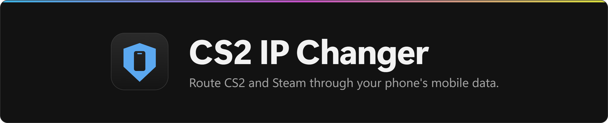
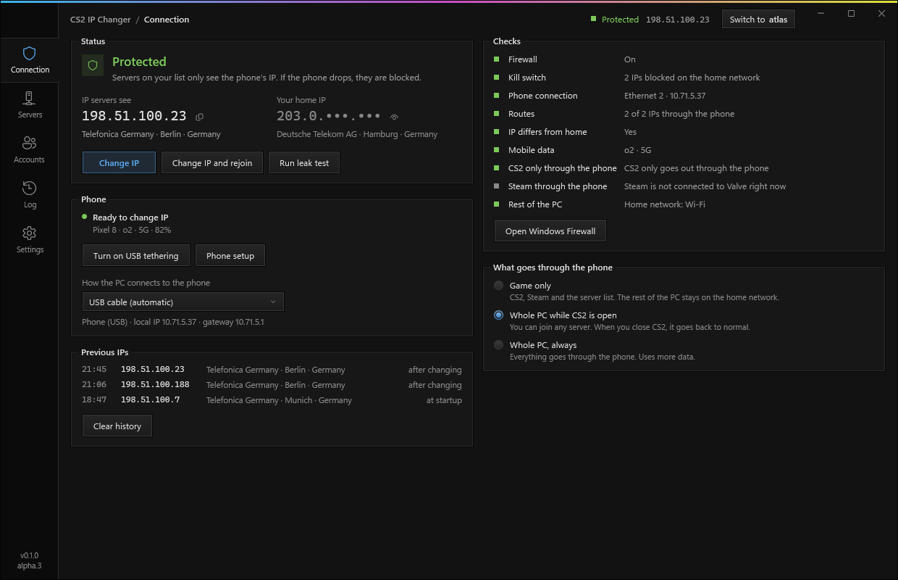
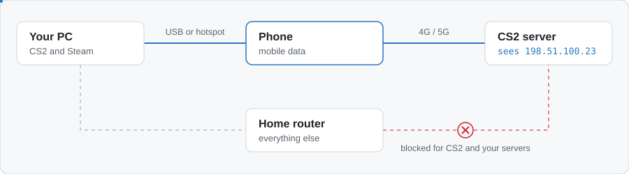
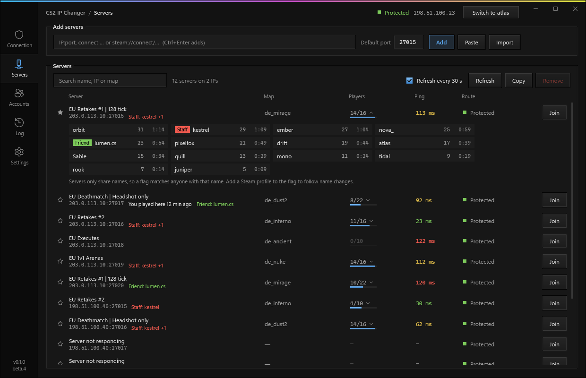
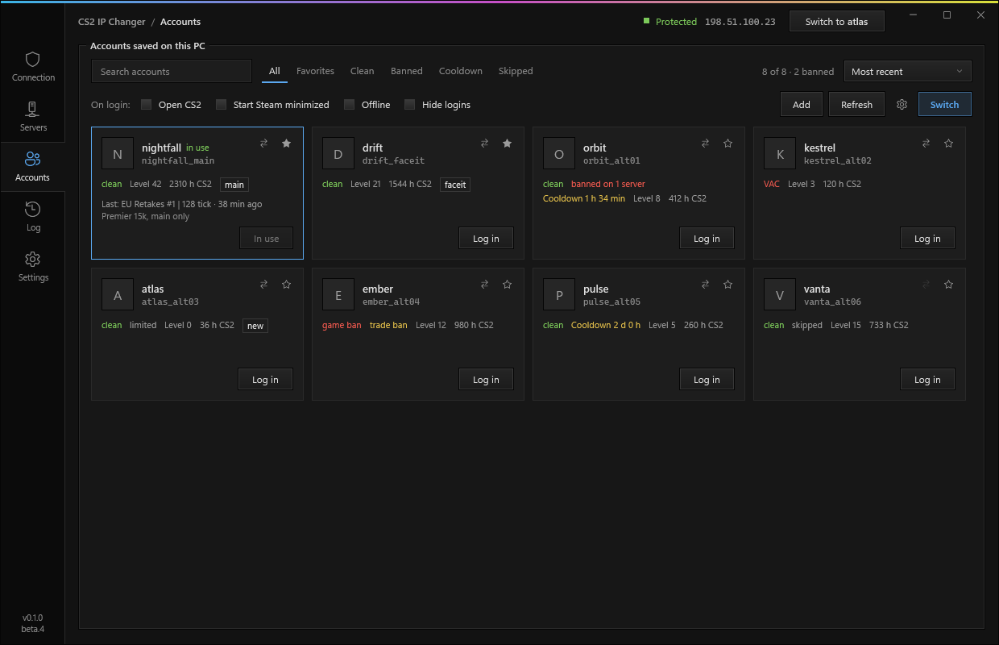

<p align="center">
  
</p>

<p align="center">
  <a href="https://github.com/Sepd0x/cs2-ip-changer/releases"></a>
  
  
  <a href="https://github.com/Sepd0x/cs2-ip-changer/attestations"></a>
</p>

<p align="center">
  <a href="https://github.com/Sepd0x/cs2-ip-changer/releases"></a>
</p>

<p align="center">
  <sub>Admin is needed for the routes and firewall rules. It never touches the game process or its files. No telemetry, no account. <a href="#check-your-download">Check your download</a>.</sub>
</p>

<p align="center">
  <a href="#how-it-works">How it works</a>
  &nbsp;·&nbsp;
  <a href="#setup">Setup</a>
  &nbsp;·&nbsp;
  <a href="#faq">FAQ</a>
  &nbsp;·&nbsp;
  <a href="#if-something-goes-wrong">Troubleshooting</a>
  &nbsp;·&nbsp;
  <a href="CHANGELOG.md">Changelog</a>
</p>

CS2 IP Changer sends CS2 and Steam through your Android phone's mobile data, so community servers see your carrier's IP and not your home IP. If you get IP banned, change the IP from the app and join again. There's a Steam account switcher in it too.

> [!WARNING]
> This is a beta, so expect bugs. If something breaks your connection, **Settings > Restore network** removes every route and firewall rule the app added.

> [!NOTE]
> Playing over mobile data usually means higher ping, more jitter and the odd lost packet compared to your home connection, so the game can feel laggier. How much depends on your carrier, the signal where the phone sits and how busy the cell is. In Game only mode the rest of your PC stays on your home connection.

<p align="center">
  
</p>

## Who it's for

- You got IP banned on a community server and want back in.
- You play HvH or other community servers and would rather keep your home IP out of their logs.
- You switch between alt accounts a lot, or you stream and want your home IP and Steam logins off screen.

## How it works

<picture>
  <source media="(prefers-color-scheme: dark)" srcset="docs/assets/how-it-works-dark.svg">
  
</picture>

The phone shares its mobile data with the PC over USB tethering (or its hotspot). The app routes CS2, Steam and your servers through it and blocks them on your home connection, so those servers only see the carrier's IP.

## What it does

| Feature | Details |
|---|---|
| Game-only routing | CS2, Steam and the servers on your list go through the phone. Your browser, Discord and downloads stay on your home connection and don't eat your mobile data. You can send the whole PC through the phone instead: IPv4 and DNS go through the phone, and IPv6 is blocked while it's on, so nothing leaves from home. |
| Kill switch | A Windows Firewall rule blocks your listed servers on every adapter except the phone, and `cs2.exe` can only use the phone connection. If the cable comes out, the game loses connection instead of falling back to your home IP. |
| Change IP | Turns mobile data (or airplane mode) off and on over ADB until the carrier hands you a new IP. Old IPs stay in a list so you can see they really changed. |
| Change IP and rejoin | When a server kicks or bans you, the app plays a sound and offers to get a new IP and join the last server again with the same account (only once protection is confirmed). <kbd>Ctrl</kbd>+<kbd>Shift</kbd>+<kbd>F10</kbd> does it from inside the game (you can pick another key in Settings > Switch). When Steam or VAC refuses the account instead, the app says so and doesn't offer a new IP, because it wouldn't help. |
| New range check | Tells you if the new IP is in a new /16 or the same one as before, because some admins ban the whole range. It can keep trying until the range changes. |
| Live checks | Firewall, routes, the IP servers see next to your home IP, whether the phone is really on mobile data, and whether Steam uses the same connection as the game (otherwise servers kick you with "No Steam logon"). There's a leak test too. |
| Server list | Paste `IP:port`, `connect IP:port` or `steam://connect/...` links. You see name, map, players and ping, and join with one click. On a full server the app can wait for a slot and join when one opens. |
| Players | Click the player count to see who is on a server. Some communities hide the list, and the app shows "hidden" there. |
| Player flags | Flag a player as Staff or with your own label and color, by name or by Steam profile link so the flag follows name changes. Servers only share names, so a flag without a profile matches anyone with that name. |
| Follow a player | You get a sound and a notice with Join when a player you follow shows up on another server in your list. Joining them automatically is off by default and always asks while CS2 is open. |
| Server bans | When CS2's console shows a ban, the account in use gets marked for that server and for the rest of the same community (the same tag in the name, or a community name you set with right-click > Set community name). Generic names like "Retakes" or "Mirage 24/7" don't count, and neither does a shared IP on its own. Joining there with it asks first. |
| Account switcher | Switches between the Steam accounts saved on your PC without typing passwords. Switch (top bar, Accounts or <kbd>Ctrl</kbd>+<kbd>Shift</kbd>+<kbd>F9</kbd>, even mid-game) gets a new IP, logs into the next account and joins the last server again; in Settings you pick which of those steps it does. Each account shows VAC, game and trade bans and its cooldown, and Switch skips accounts on cooldown or with a ban mark on that server. |
| Clear feedback | Every command plays a short sound when it's taken and another when it's done or failed, and the top bar shows what it's doing. You hear it in game too. The sounds can be turned off. |
| Open with CS2 | Programs you pick, like Discord, Spotify or a stats tracker, open when the app opens CS2. They start as you, never with the app's admin rights. |
| Stream friendly | Hide logins keeps usernames off screen, also in the Log, and your home IP stays masked in the app. The Steam Web API key is hidden unless you click Show. |
| Updates | Once a day at most it checks for a new version and only installs it if the SHA-256 from the release matches. Before downloading it tells you the size, and warns you when the download would go through the phone's mobile data. You can turn this off. |

<table>
  <tr>
    <td width="50%"></td>
    <td width="50%"></td>
  </tr>
  <tr>
    <td align="center">Servers</td>
    <td align="center">Accounts</td>
  </tr>
</table>

## Setup

You need Windows 10 or 11 (64-bit), admin rights and an Android phone with mobile data.

1. Download `CS2IPChanger.exe` from [Releases](https://github.com/Sepd0x/cs2-ip-changer/releases) and put it in a folder only admins can change, like `C:\Program Files\CS2 IP Changer`. It runs as admin, so Downloads is a bad place for it.
2. Plug the phone in by USB, turn on USB tethering and turn off the phone's Wi-Fi, so it shares mobile data and not your home Wi-Fi. While the phone's Wi-Fi is on, the app keeps your servers and CS2 blocked.
3. Run the app (it needs admin) and paste the servers you play on into **Servers**.
4. Open **Connection**. With CS2 and Steam running, every check should be green, and the IP servers see must not be your home IP.

Windows Firewall has to be on. Third-party firewalls that turn it off (some antivirus suites) leave the app without a kill switch, and it says so.

The exe isn't code-signed, so Windows SmartScreen may warn you the first time you run it. Click More info > Run anyway, or [check your download](#check-your-download) first.

To change IP from the PC, also turn on USB debugging on the phone. If ADB isn't installed, the app can download Google's platform-tools for you (about 7 MB).

To spot kicks and bans, CS2 needs the `-condebug -conclearlog` launch options (the second one starts `console.log` fresh each time, so it doesn't grow forever). The app adds both when it opens CS2, and tells you if they're missing when you start the game from Steam.

The hotkeys are <kbd>Ctrl</kbd>+<kbd>Shift</kbd>+<kbd>F9</kbd> for Switch and <kbd>Ctrl</kbd>+<kbd>Shift</kbd>+<kbd>F10</kbd> for Change IP and rejoin. Change them in Settings > Switch. The app won't take Ctrl+Alt combinations: on many keyboards that's AltGr, which types @ and €.

The app is portable. Settings, servers and accounts are saved in `SRT_Dados` next to the exe. To uninstall, click **Restore network** first and then delete the folder.

### Check your download

Releases built by GitHub Actions come with a `CS2IPChanger.exe.sha256` file and a build attestation, which shows the exe was built from this repository's code. To check the attestation, install the [GitHub CLI](https://cli.github.com/), sign in once with `gh auth login` and run:

```powershell
gh attestation verify CS2IPChanger.exe -R Sepd0x/cs2-ip-changer
```

To check only the hash, put the `.sha256` file next to the exe and run this in PowerShell. It prints `True` if they match:

```powershell
(Get-FileHash .\CS2IPChanger.exe).Hash -eq (Get-Content .\CS2IPChanger.exe.sha256).Split()[0]
```

## If something goes wrong

The firewall rules stay in place when you close the app, on purpose, so your IP can't leak while it's closed. To undo everything:

- In the app: Settings > Restore network. It removes the routes and rules and checks that they're really gone. Protection stays off until you press Run leak test or open the app again.
- If the window won't open: run `CS2IPChanger.exe --restore`.
- If you already deleted the app: open [tools/restore.cmd](tools/restore.cmd), click Download raw file, right-click the file and pick Run as administrator, then restart the PC.

Found a bug? [Open an issue](https://github.com/Sepd0x/cs2-ip-changer/issues/new/choose) with the version (bottom left of the window) and the diagnostics (Log tab > Export diagnostics). That saves a .zip on your Desktop with the log, the app's rules and routes, Steam's connection log and CS2's console. Your home IP and API key are left out, but look through it before you post. If you paste the log instead (Copy all), blank out your IPs first.

## FAQ

<details>
<summary><b>Does the account switcher store my Steam password?</b></summary>
<br>

No. It uses the logins Steam already saved on your PC (the accounts where you ticked Remember me). To switch, it tells Steam which saved account to log into and restarts Steam, the same way other Steam account switchers work. The app never sees your password or your Steam Guard codes.
</details>

<details>
<summary><b>Why does it need admin?</b></summary>
<br>

Routes and firewall rules are system settings, and Windows only lets admins change them. That's also why the exe should live in a folder only admins can change.
</details>

<details>
<summary><b>Can this get me VAC banned?</b></summary>
<br>

It never touches the game process or its files. All it changes is Windows routing, firewall rules and which Steam account logs in. It also won't hide a cheat from VAC or any other anti-cheat, so don't use it for that.
</details>

<details>
<summary><b>I'm banned on a server. Will this get me back in?</b></summary>
<br>

If it's an IP ban, change IP and join again. A ban on your Steam account follows the account, not the IP, so a new IP won't lift it, and your other accounts aren't affected by it. The app marks that account as banned on that server and its network, and Switch won't pick it there.
</details>

<details>
<summary><b>Some admins ban a whole IP range. Does that matter?</b></summary>
<br>

After each change the app tells you whether the new IP is in a new /16 or in the same one as before. If you want it to keep going until the range changes, turn on Settings > Keep changing until the IP is in a new /16.
</details>

<details>
<summary><b>Does it stop me from getting banned?</b></summary>
<br>

No app can stop an admin from banning you. What it does is keep your home IP out of every server's ban list, so a ban never sticks to your house and getting back in takes a few seconds.
</details>

<details>
<summary><b>Why bother hiding my home IP?</b></summary>
<br>

Anyone running a community server can see the IP of every player who joins, and IP bans are tied to it. With the phone's IP, nobody gets your home connection to DDoS it, and after a ban you change IP and keep playing on the same servers.
</details>

<details>
<summary><b>My carrier uses CGNAT. Is that a problem?</b></summary>
<br>

No. You share a public IP with other customers and servers see that shared one. Change IP still works, but sometimes the carrier gives you the same IP back, so the app keeps trying (you set how many times).
</details>

<details>
<summary><b>Will my ping be worse?</b></summary>
<br>

Usually, yes. Mobile data adds latency and jitter, and some cells drop packets when they're busy, so expect a higher ping than at home and a game that can feel less smooth. A good 5G or 4G signal helps a lot: put the phone near a window, keep it charging and don't run other heavy stuff on it. The ping column in Servers is measured through the phone, so it shows what you'll get before you join.
</details>

<details>
<summary><b>Can I use the phone's Wi-Fi hotspot instead of a cable?</b></summary>
<br>

Yes. Connect the PC to the hotspot and pick it under Connection > How the PC connects to the phone. The app remembers the network name, and if Windows jumps back to your home router it blocks everything. Change IP works on the hotspot too if the phone is also plugged in by USB with USB debugging on (the cable is only for ADB, tethering can stay off).
</details>

<details>
<summary><b>What about a 4G/5G USB dongle or router?</b></summary>
<br>

It works as the connection. If the app doesn't pick it on its own, choose it under Connection > How the PC connects to the phone: USB network adapters that aren't phones (like a laptop dock's Ethernet) are only used when you pick them. Change IP needs an Android phone with ADB, though.
</details>

<details>
<summary><b>In Whole PC mode, websites take a second to open. Why?</b></summary>
<br>

While Whole PC is on, DNS can only leave through the phone and IPv6 is blocked, so nothing goes out from home. Windows may first try your home router's DNS or an IPv6 address, get blocked, and then use the phone. That can add a second or two to the first visit to a site. Game only mode doesn't do this.
</details>

<details>
<summary><b>Why does the app want <code>-condebug -conclearlog</code>?</b></summary>
<br>

`-condebug` makes CS2 write its console to `console.log`, which is how the app sees a kick or a ban. `-conclearlog` empties that file each time CS2 starts, so it doesn't grow forever. The app adds both when it opens CS2. If you start CS2 from Steam, add them to the launch options (CS2 > Properties).
</details>

<details>
<summary><b>What happens when I close the app?</b></summary>
<br>

Protection stays on, so closing the app can't leak your IP. If you'd rather have it turn off, there's a setting for that.
</details>

## Privacy

There's no telemetry and no account. The app only talks to these services:

| What for | Service |
|---|---|
| Your public IP (home and phone) | api.ipify.org, ipv4.icanhazip.com, checkip.amazonaws.com, 1.0.0.1 (Cloudflare) |
| Carrier and city of an IP | ipwho.is (over HTTPS) |
| Profiles, avatars and bans of your accounts | steamcommunity.com, Steam's avatar servers and, if you add a key, api.steampowered.com |
| Downloading ADB (only if you ask) | dl.google.com |
| Checking for updates (can be turned off) | api.github.com, github.com |

Your Steam Web API key stays on your PC, in `SRT_Dados/settings.json`.

The app measures the phone's IP by asking 1.0.0.1 (Cloudflare's `/cdn-cgi/trace`). A firewall rule keeps the app's own requests to it on the phone connection, and leaves other programs alone. Windows routes can't be set per program, though: while the phone is connected, anything on your PC that talks to 1.0.0.1 (for example, if you use it as your DNS server) goes through the phone too.

## License

All rights reserved. You can download the releases and use them. You can't copy, modify or redistribute the code without permission. Details in [LICENSE](LICENSE).

The command sounds are from [Interface Sounds](https://kenney.nl/assets/interface-sounds) by Kenney (CC0).

Not affiliated with Valve. Counter-Strike and Steam are trademarks of Valve Corporation.
