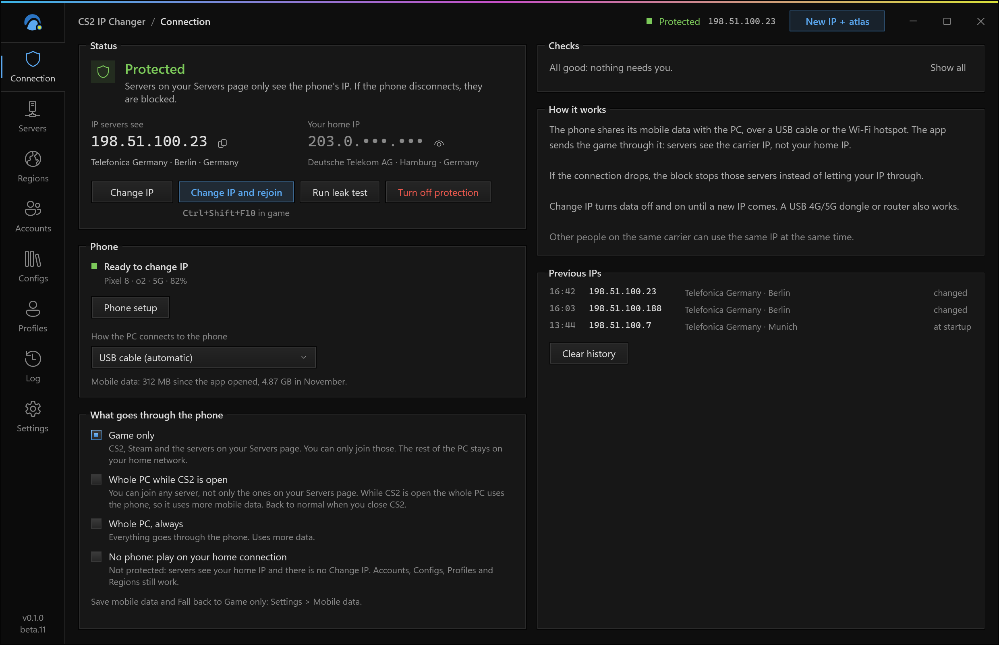
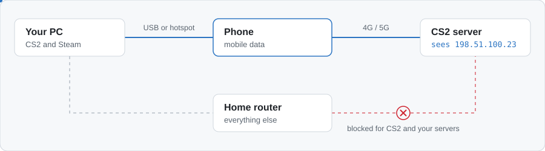
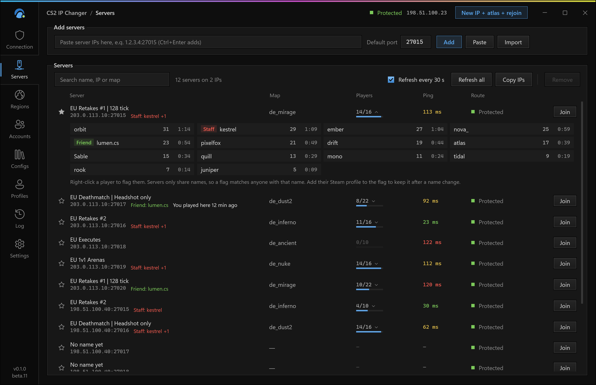
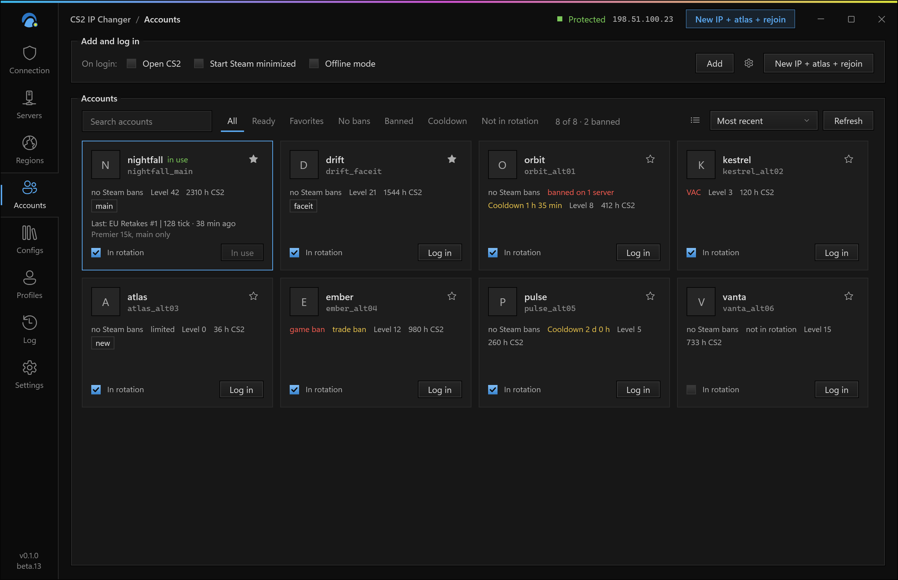
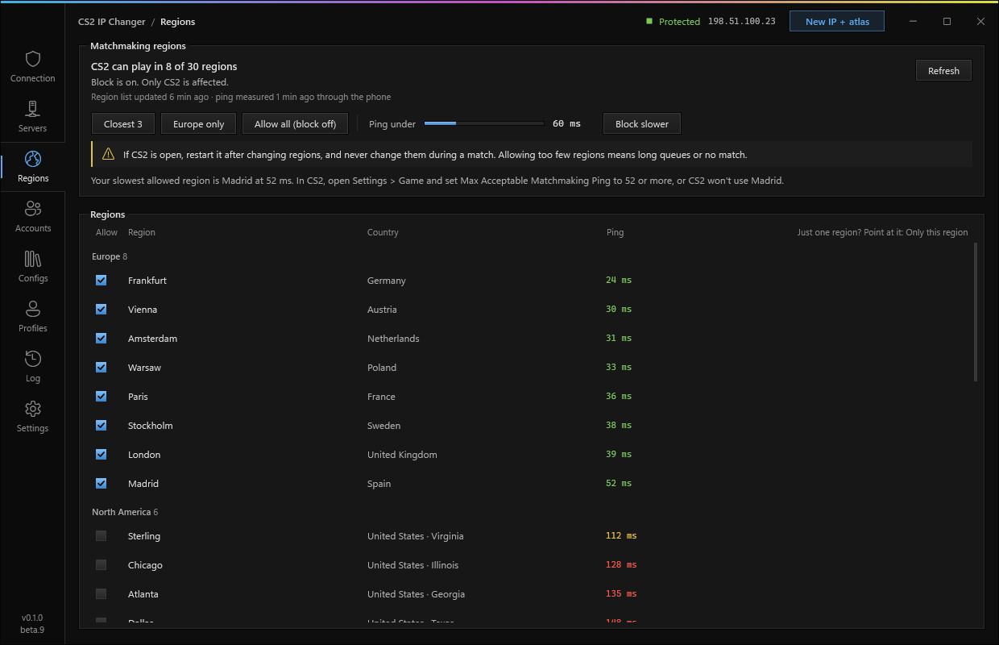
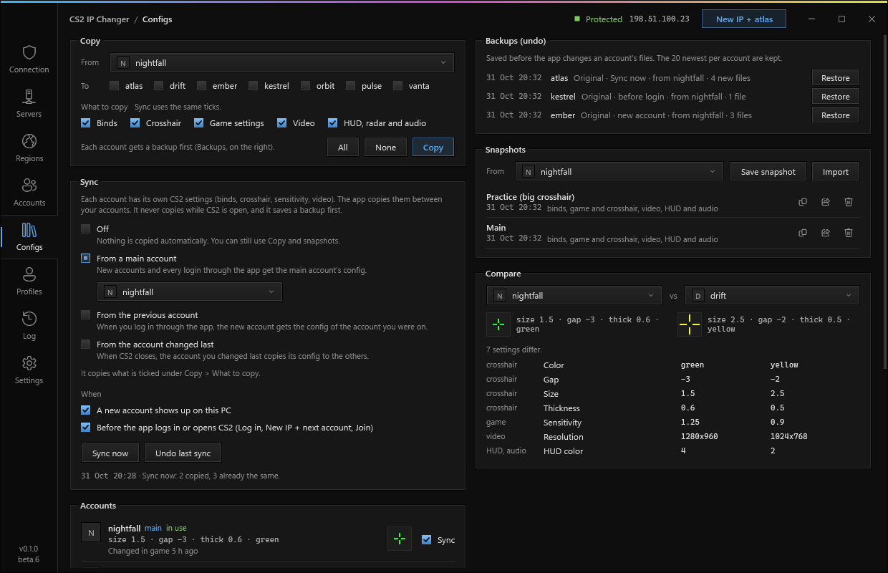
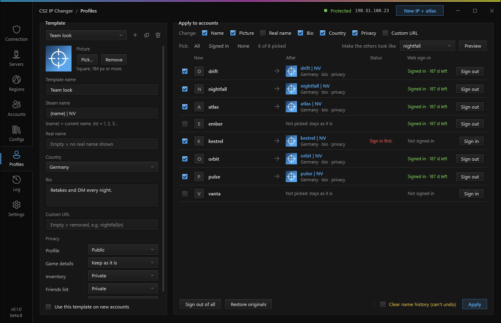

<p align="center">
  
</p>

<h1 align="center">CS2 IP Changer</h1>

<p align="center">
  <b>CS2 IP ban bypass and home IP protection for Counter-Strike 2 community servers. Free, for Windows.</b>
</p>

<p align="center">
  <a href="https://github.com/Sepd0x/cs2-ip-changer/releases/latest">
    <picture>
      <source media="(prefers-color-scheme: dark)" srcset="docs/assets/download-button-dark.svg">
      
    </picture>
  </a>
</p>

<p align="center">
  <a href="https://github.com/Sepd0x/cs2-ip-changer/releases"></a>
  
  <a href="https://github.com/Sepd0x/cs2-ip-changer/attestations"></a>
</p>

<p align="center">
  <a href="https://sepd0x.github.io/cs2-ip-changer/">Website</a>
  &nbsp;·&nbsp;
  <a href="https://sepd0x.github.io/cs2-ip-changer/#guides">Guides</a>
  &nbsp;·&nbsp;
  <a href="#faq">FAQ</a>
</p>

<p align="center">
  
</p>

CS2 IP Changer sends CS2 and Steam through your Android phone's mobile data, so community servers see your carrier's IP and not your home IP. Got IP banned? Change the IP from the app and join again; after a ban it can also log into the next account that server hasn't banned. It isn't a VPN: servers see an ordinary mobile connection, so it also works on servers that block VPNs and datacenter IPs. In the same app: a Steam account switcher, a CS2 config manager, a Steam profile editor and a matchmaking region picker.

> [!WARNING]
> This is a beta, so expect bugs. If something breaks your connection, **Settings > Turn off protection** removes the routes and firewall rules (`CS2IPChanger.exe --restore` removes the region block too).

## Quick start

You need Windows 10 or 11 (64-bit), admin rights and an Android phone with mobile data.

1. **Download** `CS2IPChanger.exe` from the [latest release](https://github.com/Sepd0x/cs2-ip-changer/releases/latest) and put it in a folder only admins can change, like `C:\Program Files\CS2 IP Changer`.
2. **Connect the phone.** Plug it in by USB, turn on USB tethering and turn off the phone's Wi-Fi. Stuck? Press **Phone setup** under Phone: it does each step it can and tells you the one thing left.
3. **Add your servers.** Run the app (it asks for admin) and paste the servers you play on into **Servers**.
4. **Check.** Open **Connection** with CS2 and Steam running. Every check should be green, and the IP servers see must not be your home IP.

> [!NOTE]
> The exe isn't code-signed, so Windows SmartScreen may warn you the first time you run it. Click **More info > Run anyway**, or [check your download](#check-your-download) first.

Will your ping be worse? Usually, yes: mobile data has more latency and jitter than a home line. See [the FAQ](#faq) for how to keep it low. More detail on each step in [Setup](#setup).

## Is it safe?

**It keeps its hands off the game.** It never touches the game process, its memory or its program files. It changes Windows routes and firewall rules, and which Steam account logs in. If you use them, the Configs page copies CS2's own config files between your accounts and the Profiles page changes your Steam profiles. It won't hide a cheat from VAC or any other anti-cheat, so don't use it for that.

**Why it needs admin.** Routes and firewall rules are system settings, and Windows only lets admins change them. That's also why the exe should live in a folder only admins can change, not in Downloads.

**Updates are signed.** Once a day at most the app checks for a new version (you can turn this off). It installs one only if the exe matches the release's SHA-256 and that `.sha256` file is signed with the project's own key, which is kept off GitHub. So someone who got into this repo or its releases still couldn't push an exe of their own to your PC.

**No account. Anonymous stats in the beta.** While in beta the app sends anonymous usage stats: versions, your country as two letters, the mode and counters. Never IPs, accounts, names or server addresses. [What is sent](#telemetry).

**Easy to undo.** Settings > Turn off protection removes the routes and firewall rules and checks that they're gone. `CS2IPChanger.exe --restore` removes everything, the region block too. More in [If something goes wrong](#if-something-goes-wrong).

### Check your download

Releases built by GitHub Actions come with a `CS2IPChanger.exe.sha256` file and a build attestation, which shows the exe was built from this repository's code. To check the attestation, install the [GitHub CLI](https://cli.github.com/), sign in once with `gh auth login` and run:

```powershell
gh attestation verify CS2IPChanger.exe -R Sepd0x/cs2-ip-changer
```

To check only the hash, put the `.sha256` file next to the exe and run this in PowerShell. It prints `True` if they match:

```powershell
(Get-FileHash .\CS2IPChanger.exe).Hash -eq (Get-Content .\CS2IPChanger.exe.sha256).Split()[0]
```

Each release is also scanned on VirusTotal. beta.6: [2 of 70 engines](https://www.virustotal.com/gui/file/8f8f4197b589dd80d6826a703af863c1684949f610e6acf7805102c3860314a2/detection) flag it (Google and Varist, generic "risk" labels), and Microsoft, Kaspersky, ESET, Bitdefender and Avast find nothing. An exe that isn't code-signed, asks for admin and changes firewall rules gets flagged by some engines on heuristics alone. If you see a detection that looks wrong, open an issue.

## How it works

<picture>
  <source media="(prefers-color-scheme: dark)" srcset="docs/assets/how-it-works-dark.svg">
  
</picture>

The phone shares its mobile data with the PC over USB tethering (or its hotspot). The app routes CS2, Steam and your servers through it and blocks them on your home connection, so those servers only see the carrier's IP. Your home IP stays out of their logs and ban lists, away from the admins and the plugins they run, and off screen when you stream. Other players never see your IP either way.

### CS2 IP Changer or a VPN?

| | CS2 IP Changer | VPN or proxy |
|---|---|---|
| IP the server sees | Your carrier's mobile IP, like any player on a phone hotspot | An IP from the VPN's datacenter |
| Servers that block VPNs and datacenter IPs | Works: it's an ordinary mobile connection | Often blocked |
| Getting a new IP | One click: mobile data off and on over ADB | Connect to another VPN server |
| Cost | Free, uses your phone's data plan | Usually a subscription |
| What goes through it | CS2, Steam and your servers, or the whole PC if you pick it | Usually the whole PC |
| If the connection drops | Windows Firewall kill switch: CS2 loses the connection instead of using your home IP | Depends on the VPN app |

<a id="what-it-does"></a>
## Features

<table>
  <tr>
    <td width="50%"></td>
    <td width="50%"></td>
  </tr>
  <tr>
    <td align="center">Servers</td>
    <td align="center">Accounts</td>
  </tr>
  <tr>
    <td width="50%"></td>
    <td width="50%"></td>
  </tr>
  <tr>
    <td align="center">Regions</td>
    <td align="center">Configs</td>
  </tr>
</table>

Every feature in detail: [docs/FEATURES.md](docs/FEATURES.md).

### Protection
- **Game-only routing.** CS2, Steam and your servers go through the phone; your browser, Discord and downloads stay at home. Or send the whole PC through it.
- **Kill switch.** A Windows Firewall rule keeps CS2 and your servers on the phone. If the cable comes out, the game loses connection instead of using your home IP.
- **Live checks.** Firewall, routes, the IP servers see next to your home IP, mobile data on the phone, Steam on the same connection as the game, and a leak test.
- **Connection quality.** Ping, jitter and loss through the phone every 30 seconds, with a warning when it's weak.
- **No phone mode.** Play on your home connection: nothing is blocked and servers see your home IP. Accounts, Configs, Profiles and Regions keep working.

### Change IP
- **Change IP.** Mobile data (or airplane mode) off and on over ADB until the carrier hands you a new IP.
- **Change IP and rejoin.** After a kick or ban: a new IP and back on the last server, also from inside the game with <kbd>Ctrl</kbd>+<kbd>Shift</kbd>+<kbd>F10</kbd>. After a ban it also logs into the next account that server hasn't banned.
- **New range check.** Tells you if the new IP is in a new /16, because some admins ban whole ranges, and can keep trying until it is.

### Servers
- **Server list.** Paste `IP:port`, `connect` or `steam://connect/` links, see name, map, players and ping, and join in one click. On a full server it waits for a slot.
- **Players and flags.** See who is on a server and flag players as Staff or with your own label, by name or Steam profile link.
- **Follow a player.** A sound and a Join notice when someone you follow shows up on another server in your list.
- **Server bans.** A ban in CS2's console marks that account for the server and its community, and joining there with it asks first.

### Accounts
- **Account switcher.** Uses the logins Steam already saved, no passwords. Switch (<kbd>Ctrl</kbd>+<kbd>Shift</kbd>+<kbd>F9</kbd>, even mid-game) gets a new IP, logs into the next account and joins the last server again.
- **Bans and cooldowns.** VAC, game and trade bans and the cooldown of each account. Switch skips accounts on cooldown or marked on that server.

### Regions
- **Pick your matchmaking regions.** Each region with its ping; turn them on or off, or use Only this region, Closest 3, your continent only or Ping under X ms.
- **Blocks only the relays.** One Windows Firewall rule for `cs2.exe`, on Valve's relay IPs only. Steam, friends and community servers aren't touched.

### Configs and Profiles
- **CS2 config manager.** Copies binds, crosshair, game settings, video, and HUD, radar and audio between your accounts, each on its own, with backups and Undo. [More](#cs2-config-manager).
- **Profiles.** Changes the name, picture, bio, country, privacy and custom URL of the accounts you pick, from templates, with a preview first and Restore original. [More](#profiles).

### Also
- **Stream friendly.** Hide usernames, your home IP masked in the app, and the Steam Web API key hidden unless you click Show.
- **Open with CS2.** Discord, Spotify or a stats tracker open with CS2, as you and never with the app's admin rights.
- **Sounds.** A short sound when a command is taken and another when it's done or failed, in game too. They can be turned off.

## Setup

The [Quick start](#quick-start) covers the usual case. The details:

- **Where to put the exe.** It runs as admin, so Downloads is a bad place for it. Already used it from another folder? Close it and copy `CS2IPChanger.exe` together with its `SRT_Dados` folder to the new one: copying, not moving, gives the folder the new place's permissions.
- **The phone's Wi-Fi.** It has to be off, so the phone shares mobile data and not your home Wi-Fi. While it's on, the app keeps your servers and CS2 blocked.
- **Windows Firewall has to be on.** Third-party firewalls that turn it off (some antivirus suites) leave the app without a kill switch, and it says so.
- **Change IP from the PC.** Also turn on USB debugging on the phone. If ADB isn't installed, the app can download Google's platform-tools for you (about 7 MB).
- **Launch options.** To spot kicks and bans, CS2 needs `-condebug -conclearlog` (the second one starts `console.log` fresh each time, so it doesn't grow forever). The app adds both when it opens CS2, and tells you if they're missing when you start the game from Steam.
- **Hotkeys.** <kbd>Ctrl</kbd>+<kbd>Shift</kbd>+<kbd>F9</kbd> for Switch and <kbd>Ctrl</kbd>+<kbd>Shift</kbd>+<kbd>F10</kbd> for Change IP and rejoin. Change them in Settings > Switch. The app won't take Ctrl+Alt combinations: on many keyboards that's AltGr, which types @ and €.
- **No phone with you?** Pick "No phone: play on your home connection" under What goes through the phone. Nothing is blocked, servers see your home IP, and the app says so. Until a phone has been connected once, CS2 isn't locked, so trying the app without a phone never leaves CS2 unable to connect at home.
- **Hotspot or a 4G/5G dongle** work too: pick them under Connection > How the PC connects to the phone (see the [FAQ](#faq)).
- **Portable.** Settings, servers and accounts are saved in `SRT_Dados` next to the exe. To uninstall, run `CS2IPChanger.exe --restore` first (it removes the region block too), then delete the folder and also `C:\ProgramData\CS2IPChanger` (the Windows files the exe unpacks there; the app removes older versions' folders by itself).

## If something goes wrong

The firewall rules stay in place when you close the app, on purpose, so your IP can't leak while it's closed. To undo everything:

- **In the app:** Settings > Turn off protection. It removes the routes and rules and checks that they're really gone. Protection stays off until you press Run leak test or open the app again. Regions you turned off stay off: Allow all on Regions lifts them.
- **If the window won't open:** run `CS2IPChanger.exe --restore`. It removes everything, the region block too.
- **If you already deleted the app:** open [tools/restore.cmd](tools/restore.cmd), click Download raw file, right-click the file and pick Run as administrator, then restart the PC.

Lag, or programs opened with CS2 losing their connection? Look at Connection quality in Checks. If it says Weak, the phone connection is the problem: see [Will my ping be worse?](#faq). In Whole PC mode, programs opened with CS2 go through the phone too, so a new IP cuts their connections: use Game only for them.

Found a bug? [Open an issue](https://github.com/Sepd0x/cs2-ip-changer/issues/new/choose) with the version (bottom left of the window) and the diagnostics (Log page > Save bug report). That saves a .zip on your Desktop with the log, the app's rules and routes, Steam's connection log, CS2's console and the details of any error the app caught. Your home IP, API key, logins, Steam and player names, SteamIDs, Wi-Fi names, emails and your Windows user are hidden in it, but look through it before you post. If you paste the log instead (Copy all), blank out your IPs first.

## FAQ

<details>
<summary><b>Is it a VPN? Does it work on servers that block VPNs?</b></summary>
<br>

No, it isn't a VPN, and yes, it works there. A VPN sends your traffic through a datacenter, and many community servers block datacenter and VPN IP ranges. This app sends CS2 and Steam through your own phone's mobile data, so the server sees an ordinary mobile connection from your carrier, the same as someone playing on a phone hotspot. There's no VPN server in between and no subscription.
</details>

<details>
<summary><b>Does the account switcher store my Steam password?</b></summary>
<br>

No. It uses the logins Steam already saved on your PC (the accounts where you ticked Remember me). To switch, it tells Steam which saved account to log into and restarts Steam, the same way other Steam account switchers work. Switching never asks for your password or your Steam Guard codes.

The only place you type a password is Sign in on the Profiles page, and only if you want the app to change a profile. Even there it's used once and never saved: the app keeps an encrypted Steam sign-in token instead ([what happens to your login](#profiles)). You can also sign in with a QR code from the Steam app and type nothing.
</details>

<details>
<summary><b>Why does it need admin?</b></summary>
<br>

Routes and firewall rules are system settings, and Windows only lets admins change them. That's also why the exe should live in a folder only admins can change.
</details>

<details>
<summary><b>Can this get me VAC banned?</b></summary>
<br>

It never touches the game process, its memory or its program files. It changes Windows routing and firewall rules and which Steam account logs in. If you use them, the Configs page copies CS2's config files (binds, crosshair, video and so on) between your accounts, the same files CS2 writes when you change a setting, and the Profiles page changes your Steam profiles. It also won't hide a cheat from VAC or any other anti-cheat, so don't use it for that.
</details>

<details>
<summary><b>Does forcing a region get me banned?</b></summary>
<br>

The Regions page doesn't touch the game, its files or its memory. It adds one outbound Windows Firewall rule that stops `cs2.exe` from reaching Valve's relays in the regions you turned off, so CS2 sees those regions as unreachable and matchmaking plays elsewhere. To the game it looks the same as a bad connection to those relays. Still, we can't speak for Valve and can't promise anything about how they treat it. Allow all removes the rule, and so does `--restore`. Turn off protection and No phone mode leave it on.
</details>

<details>
<summary><b>I'm banned on a server. Will this get me back in?</b></summary>
<br>

If it's an IP ban, change IP and join again. A ban on your Steam account follows the account, not the IP, so a new IP won't lift it, and your other accounts aren't affected by it. The app marks that account as banned on that server and its network, and Switch won't pick it there.
</details>

<details>
<summary><b>Some admins ban a whole IP range. Does that matter?</b></summary>
<br>

After each change the app tells you whether the new IP is in a new /16 or in the same one as before. If you want it to keep going until the range changes, turn on Settings > Keep changing until the IP is in a new range.
</details>

<details>
<summary><b>Does it stop me from getting banned?</b></summary>
<br>

No app can stop an admin from banning you. What it does is keep your home IP out of every server's ban list, so a ban never sticks to your house and getting back in takes a few seconds.
</details>

<details>
<summary><b>Why bother hiding my home IP? Who can see it?</b></summary>
<br>

The admins of every community server you join can see your IP, and so can the plugins they run on it. Other players can't. IP bans are tied to it, and it's in the server's logs. With the phone's IP, nobody on the server side gets your home connection to DDoS it, and after a ban you change IP and keep playing on the same servers.
</details>

<details>
<summary><b>My carrier uses CGNAT. Is that a problem?</b></summary>
<br>

No. You share a public IP with other customers and servers see that shared one. Change IP still works, but sometimes the carrier gives you the same IP back, so the app keeps trying (you set how many times).
</details>

<details>
<summary><b>Will my ping be worse?</b></summary>
<br>

Usually, yes. Mobile data adds latency and jitter, and some cells drop packets when they're busy, so expect a higher ping than at home and a game that can feel less smooth. A good 5G or 4G signal helps a lot: put the phone near a window, keep it charging and don't run other heavy stuff on it. The ping column in Servers is measured through the phone, so it shows what you'll get before you join, and Connection quality in Checks tells you when the connection itself is weak.

If it stays weak: Change IP can put you on another cell, and Game only keeps the rest of the PC off the phone (the app does this on its own while the connection is weak, unless you turn it off). On the phone you can also check Settings > Connections > Mobile networks > Network mode is set to include 5G. Forcing 5G only helps where the 5G signal is good, and some phones show 5G as 4G (LTE) because 5G there runs on top of 4G.
</details>

<details>
<summary><b>Can I use the phone's Wi-Fi hotspot instead of a cable?</b></summary>
<br>

Yes. Connect the PC to the hotspot and pick it under Connection > How the PC connects to the phone. The app remembers the network name, and if Windows jumps back to your home router it blocks everything. Change IP works on the hotspot too if the phone is also plugged in by USB with USB debugging on (the cable is only for ADB, tethering can stay off).
</details>

<details>
<summary><b>What about a 4G/5G USB dongle or router?</b></summary>
<br>

It works as the connection. If the app doesn't pick it on its own, choose it under Connection > How the PC connects to the phone: USB network adapters that aren't phones (like a laptop dock's Ethernet) are only used when you pick them. Change IP needs an Android phone with ADB, though.
</details>

<details>
<summary><b>In Whole PC mode, websites take a second to open. Why?</b></summary>
<br>

While Whole PC is on, DNS can only leave through the phone and IPv6 is blocked, so nothing goes out from home. Windows may first try your home router's DNS or an IPv6 address, get blocked, and then use the phone. That can add a second or two to the first visit to a site. Game only mode doesn't do this.
</details>

<details>
<summary><b>Why does the app want <code>-condebug -conclearlog</code>?</b></summary>
<br>

`-condebug` makes CS2 write its console to `console.log`, which is how the app sees a kick or a ban. `-conclearlog` empties that file each time CS2 starts, so it doesn't grow forever. The app adds both when it opens CS2. If you start CS2 from Steam, add them to the launch options (CS2 > Properties).
</details>

<details>
<summary><b>What happens when I close the app?</b></summary>
<br>

Protection stays on, so closing the app can't leak your IP. If you'd rather have it turn off, there's a setting for that. Until a phone has been connected once, CS2 isn't locked, so trying the app without a phone never leaves CS2 unable to connect at home.
</details>

## CS2 config manager

The Configs page copies CS2's config files between your Steam accounts: binds, crosshair, the other game settings (sensitivity, viewmodel), video, and HUD, radar and audio, each on its own. Sync from a main account, from the account you used before, or let the latest change win. It runs when a new account shows up, before the app logs in or opens CS2, or when you click Sync now.

Nothing is written while CS2 is open, every change keeps a backup (Undo last sync puts it back), and an account can be left out. Save a config as a named snapshot, export it as a .zip for another PC, and compare two accounts setting by setting with a crosshair preview. Video keeps this PC's refresh rate and monitor. Steam Cloud, backups and the files it touches: [docs/FEATURES.md](docs/FEATURES.md#cs2-config-manager). Nothing from your configs goes into Save bug report.

## Profiles

<p align="center">
  
</p>

The Profiles page changes how your Steam accounts look to others. Make a template (name, picture, real name, bio, country, privacy, custom URL), pick the accounts, check the preview and click Apply. Or make them all look like one account in one click. `{name}` and `{n}` work in names, and a login never ends up on a profile: there is no `{login}`, and the app refuses a name, bio or URL that would show one. A copy of each profile is kept first, so Restore original puts it back. Pictures are saved again as a new JPG, so no photo data (EXIF, GPS) reaches Steam. Everything it keeps stays on your PC in `SRT_Dados/profiles`. More in [docs/FEATURES.md](docs/FEATURES.md#profiles).

**What happens to my login.** Changing a profile needs a Steam web session for that account, the same one your browser has on steamcommunity.com. When you click Sign in, the app signs in the way Steam's own login page does: you type the password (or scan a QR code with the Steam app and type nothing) and approve Steam Guard. The password goes straight from the box into Steam's encryption key for that sign-in and is wiped from memory right after. It is never saved, never written to the Log and never sent anywhere but Steam. What the app keeps is Steam's sign-in token for that account, encrypted with Windows (DPAPI: only your Windows user can open it) in `SRT_Dados/profiles/sessions`, one file per account that only your Windows user can read. It's never in the Log, in Save bug report or in the usage stats. Steam lists the sign-in under Steam > Settings > Security > Authorized devices as "CS2 IP Changer", where you can end it at any time, and Forget (per account) or Forget all sign-ins deletes the files. For this the app only talks to Steam (steamcommunity.com, login.steampowered.com, api.steampowered.com and Steam's picture servers), over HTTPS. Signing in is off in the recording build, and the Profiles page there hides names and pictures like the Accounts page.

## Privacy

There's no account. While the app is in beta it sends anonymous usage stats ([Telemetry](#telemetry)). Besides that, it only talks to these services:

| What for | Service |
|---|---|
| Your public IP (home and phone) | api.ipify.org, ipv4.icanhazip.com, checkip.amazonaws.com, 1.0.0.1 (Cloudflare) |
| Carrier and city of an IP | ipwho.is (over HTTPS) |
| Profiles, avatars and bans of your accounts, and the public profile of a link you paste in Profiles | steamcommunity.com, Steam's avatar servers and, if you add a key, api.steampowered.com |
| Regions: Valve's relay list (at every start, and every hour while regions are off) | api.steampowered.com (`GetSDRConfig`, no key), plus pings to Valve's relays through the phone (your home connection in No phone mode) |
| Changing your profiles (only accounts you sign in to on the Profiles page) | steamcommunity.com, login.steampowered.com, api.steampowered.com and Steam's avatar servers |
| Downloading ADB (only if you ask) | dl.google.com |
| Checking for updates (can be turned off) | api.github.com, github.com |
| Anonymous usage stats (beta, [Telemetry](#telemetry)) | the project's Cloudflare Worker (source in [`worker/stats`](worker/stats)) |

Your Steam Web API key stays on your PC, in `SRT_Dados/settings.json`. The Profiles sign-ins stay on your PC too, encrypted, in `SRT_Dados/profiles/sessions`.

The app measures the phone's IP by asking 1.0.0.1 (Cloudflare's `/cdn-cgi/trace`). A firewall rule keeps the app's own requests to it on the phone connection, and leaves other programs alone. Windows routes can't be set per program, though: while the phone is connected, anything on your PC that talks to 1.0.0.1 (for example, if you use it as your DNS server) goes through the phone too.

## Telemetry

While CS2 IP Changer is in beta, it sends anonymous usage stats so bugs can be found and the parts people use get better. It's always on in the beta. If you don't want that, don't use the beta.

Once when the app has been open for 20 seconds, and then once a day, it sends:

- a random ID made on your PC the first time (not tied to you, your PC, Steam or anything else; it only lets the same install be counted once a day)
- the app version and the Windows version
- your country, as two letters (for example `PT`). Cloudflare works it out from the connection the report comes from (with a VPN, it's the VPN's country); the Worker only gets the country, never the IP
- the mode (Game only, Whole PC while CS2 is open, Whole PC always, No phone) and how the phone is connected (USB, hotspot)
- minutes the app was open
- how many times each button and hotkey was used, counted by the name of its code (for example `ChangeIp_Click`), never by what's on it
- a few counters: IP changes that worked, that got the same IP or no network, kicks and bans the app saw, errors in the Log, and where Phone setup stopped (the step's name, like `phone_setup_tetheroff`)
- how many servers, accounts, flagged players and "Open with CS2" programs are in your lists, and how many regions are turned off (the number only)
- errors as their type and place in the app's code (for example `NullReferenceException` in `MainWindow.QueryServers`), never their message

It never sends IPs (yours, the phone's or servers'), server names or addresses, Steam accounts, logins, names or IDs, your carrier, city or region, players' names, file paths or anything you typed.

The server is a Cloudflare Worker whose code is in this repo ([`worker/stats`](worker/stats)). Cloudflare has to see your IP to deliver the request, like with any website, and gives the Worker only the country; the Worker never reads the IP or stores it, and its request logs are off. The stats are stored per day in a database with no IP column ([`schema.sql`](worker/stats/schema.sql)). The recording build sends nothing.

## License

All rights reserved. The source is public so you can read it and check what the app does. The releases are free to download and use on your own PCs, for personal use. You can't copy, modify or redistribute the code or the exe without permission. That's so nobody can re-upload a changed exe under this name. Details in [LICENSE](LICENSE).

The command sounds are from [Interface Sounds](https://kenney.nl/assets/interface-sounds) by Kenney (CC0).

Not affiliated with Valve. Counter-Strike and Steam are trademarks of Valve Corporation.
