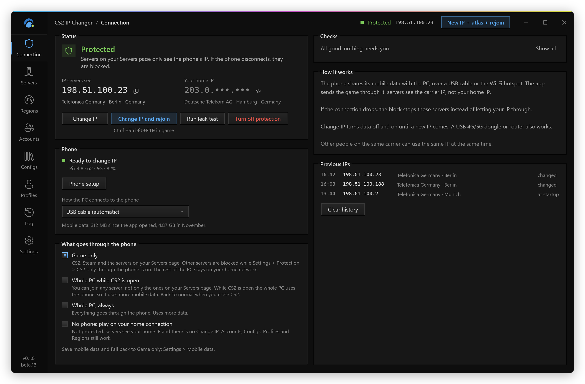
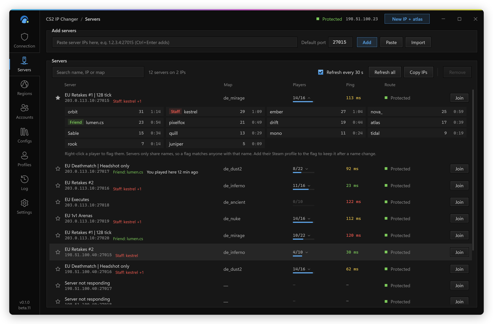
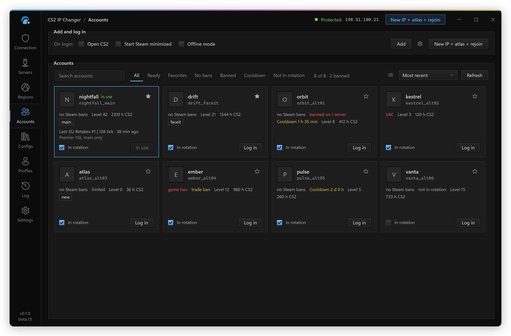
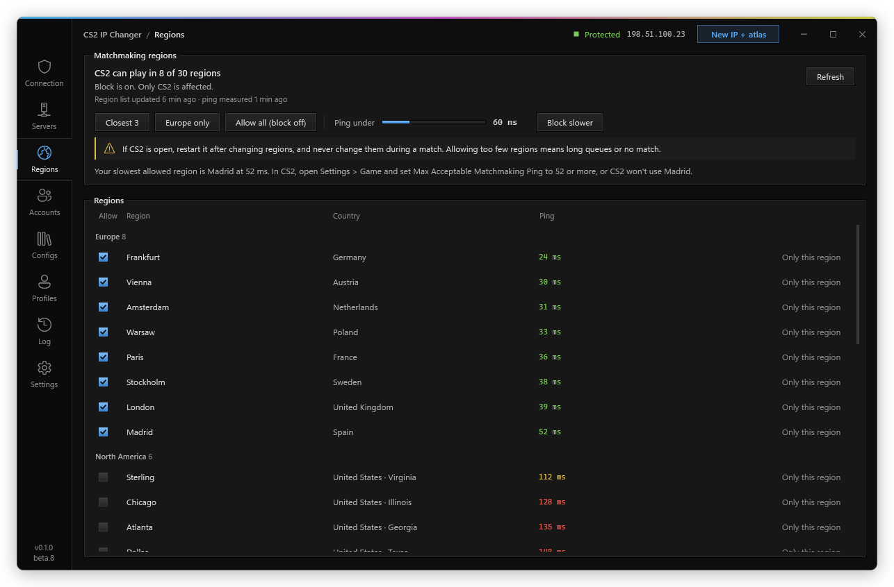
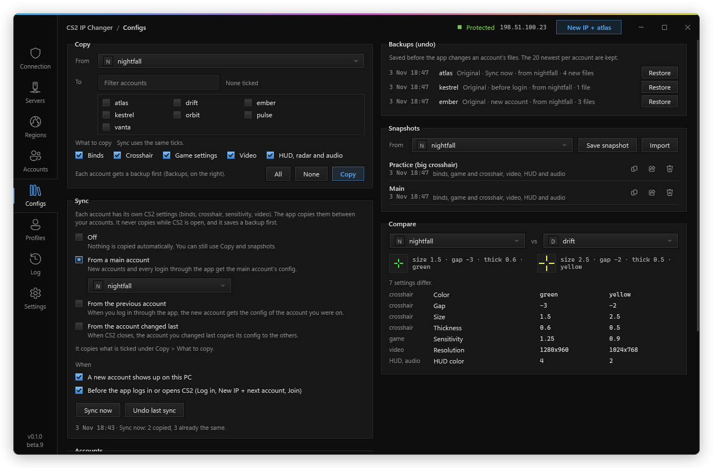
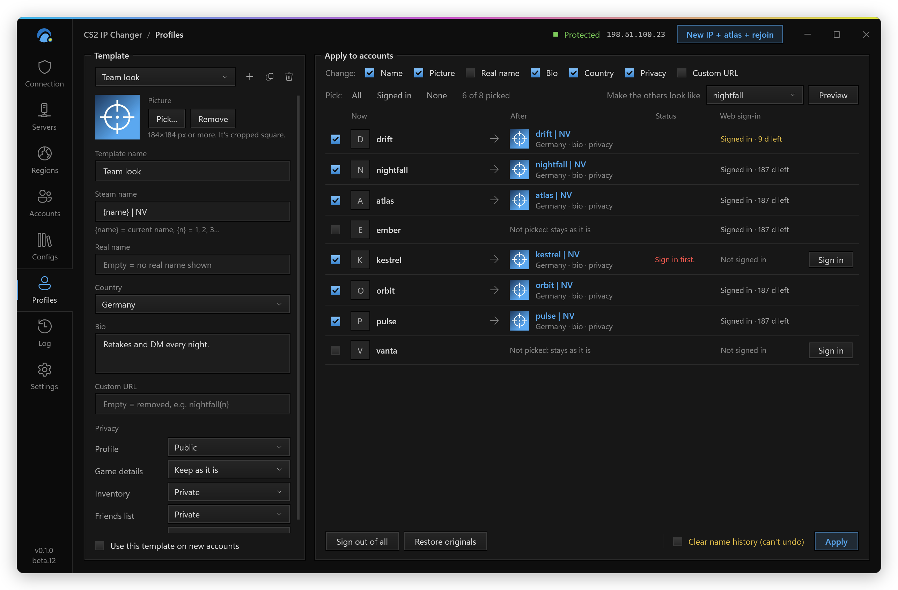

# CS2 IP Changer: every feature in detail

The short version is in the [README](../README.md#features). This page has the details of each feature, grouped by the page of the app where you find it.

- [Protection](#protection)
- [Change IP](#change-ip)
- [Servers](#servers)
- [Accounts](#accounts)
- [Regions](#regions)
- [CS2 config manager](#cs2-config-manager)
- [Profiles](#profiles)
- [Everything else](#everything-else)

## Protection

<picture>
  <source srcset="assets/shots/connection.webp" type="image/webp">
  
</picture>

**Game-only routing.** CS2, Steam and the servers on your list go through the phone. Your browser, Discord and downloads stay on your home connection and don't eat your mobile data. You can send the whole PC through the phone instead: IPv4 and DNS go through the phone, and IPv6 is blocked while it's on, so nothing leaves from home.

**No phone mode.** No phone with you? Pick "No phone: play on your home connection" under What goes through the phone. Nothing is blocked and servers see your home IP, and the app says so in plain words. Change IP is off. Accounts, Configs, Profiles and Regions keep working. Until a phone has been connected once on your PC, CS2 isn't locked, so trying the app without a phone never leaves CS2 unable to connect at home.

**Block if the phone drops.** The kill switch: a Windows Firewall rule blocks your listed servers on every adapter except the phone, and `cs2.exe`'s game traffic (UDP) can only use the phone connection. If the cable comes out, the game loses connection instead of falling back to your home IP. While the phone's Wi-Fi is on, the app keeps your servers and CS2 blocked, so the phone can't hand you your home Wi-Fi by mistake.

**Connection quality.** Every 30 seconds the app pings through the phone and shows ping, jitter and loss in Checks: Good, Fair or Weak. Weak means 150 ms or more, jitter of 40 ms or more, 2 of 8 pings lost, or a 3G/2G network, two measurements in a row. When it's weak the app warns you, and if Whole PC is on it drops to Game only so CS2 doesn't share the phone with your browser, Discord and downloads. It goes back to Whole PC once the connection is fine again and CS2 is closed, never mid-match. Turn off Fall back to Game only on a weak connection in Settings > Protection to stop that.

**Live checks.** Windows Firewall, routes, the IP servers see next to your home IP, whether the phone is really on mobile data, and whether Steam uses the same connection as the game (otherwise servers kick you with "No Steam logon"), and where other apps go. There's a leak test too.

**Phone setup.** Under Phone: a list of steps (the phone tool, the USB cable and its driver, USB debugging, allowing this PC, tethering, the phone's Wi-Fi, where other apps go) that check themselves every 2 seconds, green when done and red when next. Where the app can do the step, it has a button.

**Turn on protection.** Protection starts off each time the app opens: CS2 and servers use your home connection, and the app still checks the phone. Turn on protection (in Status or the icon's menu) puts the block, the routes and the CS2 lock in place, and it stays on until you turn it off. Settings > Protection > Turn on protection when the app starts does it by itself. An update made with protection on keeps it on, and so does a start with CS2 still open and the block of the last run in place.

## Change IP

**Change IP.** Turns mobile data (or airplane mode) off and on over ADB until the carrier hands you a new IP. Old IPs stay in a list so you can see they really changed. With CGNAT the carrier sometimes gives the same IP back, so the app keeps trying (you set how many times). With "Keep changing until the connection is good", a new IP that's too jittery is changed again with airplane mode, so the phone looks for another cell (not on the hotspot).

**Change IP and rejoin.** When a server kicks or bans you, the app plays a sound and offers to get a new IP and join the last server again (only once protection is confirmed). After a ban it also logs into the next account that server hasn't banned, because the ban is on the IP and the account. <kbd>Ctrl</kbd>+<kbd>Shift</kbd>+<kbd>F10</kbd> does it from inside the game (you can pick another key in Settings > New IP + next account). When Steam or VAC refuses the account instead, the app says so and doesn't offer a new IP, because it wouldn't help.

**Kick, ban or something else.** CS2 only gets a reason code from the server, so the app reads that code and what the server said in the half minute before (ban plugins like CS2-SimpleAdmin say the length, VPN blockers say "VPN/Proxy detected"). A ban, with its length if the server said it (the ban mark on that account ends with it), and a VPN or proxy block offer New IP + next account. A kick (AFK, vote, admin) offers a plain rejoin with the same account and IP. A full server, a reserved slot, a timeout or a lost connection say what happened and offer nothing. A map change or leaving yourself say nothing. On Valve's matchmaking servers nothing is shown or counted.

**New range check.** Tells you if the new IP is in a new /16 or the same one as before, because some admins ban the whole range. Settings > Keep changing until the IP is in a new range makes it keep trying until the range changes.

## Servers

<picture>
  <source srcset="assets/shots/servers.webp" type="image/webp">
  
</picture>

**Server list.** Paste `IP:port`, `connect IP:port` or `steam://connect/...` links. You see name, map, players and ping (measured through the phone), and join with one click. On a full server the app can wait for a slot and join when one opens. Local network addresses (your router, `192.168.x.x`, `10.x.x.x`) are refused.

**Players.** Click the player count to see who is on a server. Some communities hide the list, and the app shows "hidden" there.

**Player flags.** Flag a player as Staff or with your own label and color, by name or by Steam profile link so the flag follows name changes. Servers only share names, so a flag without a profile matches anyone with that name.

**Follow a player.** You get a sound and a notice with Join when a player you follow shows up on another server in your list. Joining them automatically is off by default and always asks while CS2 is open.

**Server bans.** When CS2's console shows a ban, the account in use gets marked for that server and for the rest of the same community (the same tag in the name, or a community name you set with right-click > Set community name). Generic names like "Retakes" or "Mirage 24/7" don't count, and neither does a shared IP on its own. Joining there with it asks first.

## Accounts

<picture>
  <source srcset="assets/shots/accounts.webp" type="image/webp">
  
</picture>

**Account switcher.** Switches between the Steam accounts saved on your PC without typing passwords. **New IP + next account** (the New IP + &lt;account&gt; button in the top bar or on Accounts, or <kbd>Ctrl</kbd>+<kbd>Shift</kbd>+<kbd>F9</kbd>, even mid-game) gets a new IP, logs into the next account and joins the last server again; in Settings > New IP + next account you pick which of those steps it does. CS2 only opens once Steam is really on the new account; if Steam logs in to another one, the app tells you. A failed switch puts Steam's previous account back.

**Bans and cooldowns.** Each account shows VAC, game and trade bans and its cooldown, and New IP + next account skips accounts on cooldown or with a ban mark on that server.

**In rotation.** Each account card has an In rotation checkbox. Untick it and New IP + next account leaves that account out; it shows as Not in rotation.

**Passwords.** It uses the logins Steam already saved on your PC (the accounts where you ticked Remember me). To switch, it tells Steam which saved account to log into and restarts Steam. Switching never asks for your password or your Steam Guard codes.

## Regions

<picture>
  <source srcset="assets/shots/regions.webp" type="image/webp">
  
</picture>

Pick where CS2 matchmaking (Premier, Competitive, Casual, Deathmatch, Wingman) can put you. Each region shows its ping through the phone (your home connection in No phone mode), and you turn regions on or off, or use Only this region, Closest 3, your continent only (Europe only, North America only…, from your lowest ping or your home country), Allow all (block off) or Ping under X ms.

Turned-off regions are blocked with one Windows Firewall rule for `cs2.exe` only, on Valve's relay IPs only: Steam, friends and community servers aren't touched. The relay list comes from Valve and is saved for when you're offline, and the rule is rebuilt when Valve changes the list. Changes apply at once; CS2 re-measures the regions on its next start.

Regions don't depend on the phone or on protection: they stay off until you click Allow all (block off), and `--restore` removes the rule too. Blocking too much means long queues or no match.

## CS2 config manager

<picture>
  <source srcset="assets/shots/configs.webp" type="image/webp">
  
</picture>

CS2 keeps each account's settings in `Steam\userdata\<id>\730\local\cfg`: binds in `cs2_user_keys_0_slot0.vcfg`, the crosshair and game settings in `cs2_user_convars_0_slot0.vcfg`, video in `cs2_video.txt`, and HUD, radar and audio in `cs2_machine_convars.vcfg`. The Configs page copies those files between your accounts.

- **Sync modes.** Off (the default), From a main account, From the previous account, or From the account changed last (when CS2 closes, the account you changed last copies its config to the others). Right-click an account > Use as main config is the quick way in.
- **When.** When a new account shows up on the PC, and right before the app logs in (Log in, New IP + next account) or opens CS2 for a join. Sync now does it by hand. Turn Sync off on an account and the sync never touches it.
- **Video stays this PC's.** Copying Video copies the resolution and the graphics settings, but each account keeps this PC's refresh rate and monitor, so a 144 Hz screen doesn't end up at 60 Hz.
- **Crosshair only.** Crosshair and Game settings are separate: you can copy just the crosshair and keep each account's sensitivity, or the other way round.
- **Never with CS2 open.** CS2 saves its config when it closes and would undo the copy, so the copy waits and goes in when CS2 closes.
- **Steam Cloud.** Binds and game settings are also kept in Steam Cloud. The app writes the cloud copy too, the same way CS2 does when it saves, so Steam uploads the new one on the next launch. If an account was played on another PC since, Steam may bring that version back, or ask which one to keep. If your settings keep going back, turn off Steam Cloud for CS2 (CS2 > Properties > General).
- **Backups (undo).** Before it changes an account, the app saves that account's files in `SRT_Dados\configs\backups` (the 20 newest per account, plus the oldest one for good, marked Original). Undo last sync puts back everything the last sync changed, and any backup can be restored on its own.
- **Snapshots.** Save an account's config under a name, copy it to any accounts later, or export it as a `.zip` to use on another PC. The `.zip` has only the config files and the name, never the account. Video settings from a PC with another graphics card may be redetected by CS2.
- **Compare.** Pick two accounts or snapshots to see the settings that differ, in words where the app knows them (sensitivity, crosshair, resolution, viewmodel, binds), and a preview of each crosshair.

Nothing from your configs goes into Save bug report.

## Profiles

<picture>
  <source srcset="assets/shots/profiles.webp" type="image/webp">
  
</picture>

The Profiles page changes how your Steam accounts look to others. Make a template (name, picture, real name, bio, country, privacy, custom URL), pick the accounts, check the preview and click Apply. The accounts are changed one after another with a pause between them, and each result is shown next to the account in plain words.

- **Preview**: pick an account under "Make the others look like" and every other account gets its name, picture, real name, bio and country. Right-click an account on Accounts > Copy look to… does the same.
- **Names with numbers**: `nightfall {n}` gives nightfall 1, nightfall 2… in the order of the list. `{name}` is the account's name now, so `{name} | NV` adds a tag. There is no `{login}`, on purpose: a login on a public profile is half of what someone needs to take the account. The app also refuses a name, bio or URL that would show any login saved on your PC.
- **Copy from an account** (the copy button next to the template) reads that account's look into the template. **From a Steam profile link** in the same menu takes any profile (`steamcommunity.com/id/…`, `/profiles/…` or a SteamID64), like an account you have on another PC: its public name, picture, real name, bio and country. What that profile keeps private stays as it is on each account.
- **Undo**: before the first change on an account, the app keeps a copy of its profile (name, details, privacy and picture) in `SRT_Dados/profiles/snapshots`, the original and the 5 newest per account. Right-click > Restore original puts it back; Undo the last change goes back one step.
- **New accounts**: tick "Use this template on new accounts" and an account that shows up later in Steam is offered that look (the app asks you to sign in to it once).
- **Clear name history** (next to Apply) also empties "previously known as". That one is permanent: Steam has no way back, and Restore can't bring them back either. It's off unless you tick it, and it unticks itself after every Apply.

Pictures are cropped square and saved again as a new JPG before they're used, so nothing from the original file (photo data like EXIF or GPS) reaches Steam.

**What it keeps on your PC.** All of it is in `SRT_Dados/profiles`: your templates (`templates.json`) and their pictures (`avatars`), the copies for undo (`snapshots`, one folder per account), the encrypted sign-ins (`sessions`) and the list of accounts it has already seen, so it knows when a new one shows up (`known.json`). Nothing of it leaves your PC except what you apply to Steam.

### What happens to my login

Changing a profile needs a Steam web session for that account, the same one your browser has on steamcommunity.com. When you click Sign in, the app signs in the way Steam's own login page does: you type the password (or scan a QR code with the Steam app and type nothing) and approve Steam Guard. The password goes straight from the box into Steam's encryption key for that sign-in and is wiped from memory right after. It is never saved, never written to the Log and never sent anywhere but Steam.

What the app keeps is Steam's sign-in token for that account, encrypted with Windows (DPAPI: only your Windows user can open it) in `SRT_Dados/profiles/sessions`, one file per account that only your Windows user can read. It's never in the Log, in Save bug report or in the usage stats. Steam lists the sign-in under Steam > Settings > Security > Authorized devices as "CS2 IP Changer", where you can end it at any time, and Sign out (per account) or Sign out of all deletes the files.

For this the app only talks to Steam (steamcommunity.com, login.steampowered.com, api.steampowered.com and Steam's picture servers), over HTTPS. Signing in is off in the recording build, and the Profiles page there hides names and pictures like the Accounts page.

## Everything else

**Clear feedback.** Every command plays a short sound when it's taken and another when it's done or failed, and the top bar shows what it's doing. You hear it in game too. The sounds can be turned off.

**Open with CS2.** Programs you pick, like Discord, Spotify or a stats tracker, open when the app opens CS2. They start as you, never with the app's admin rights. A program that needs admin gets an As admin switch: Windows asks first (UAC).

**Stream friendly.** Hide usernames keeps usernames off screen, also in the Log, and your home IP stays masked in the app. The Steam Web API key is hidden unless you click Show. While OBS Studio or Streamlabs is open, Hide usernames turns on by itself (Settings > Steam).

**In the background.** An icon next to the clock shows the protection state when you point at it; click it to open the app, right-click it for Turn protection on or off, New IP + next account, Change IP, Regions and Quit. While the window is hidden, the app's notices come as Windows notifications. In Settings > Background and data, all off until you turn them on:
- **Close to the notification area**: the X hides the window and protection carries on.
- **Start with Windows**: a scheduled task named "CS2 IP Changer" opens the app in the notification area when you sign in, with its admin rights and without a UAC prompt each time. Like any start, protection is off until you turn it on, unless Settings > Protection > Turn on protection when the app starts is ticked. Only the copy in `C:\Program Files\CS2 IP Changer` can do this.
- **Mobile data warning**: the Phone box on Connection counts what went through the phone's adapter since the app opened and this month, and the app warns once a month at the GB you pick. It counts everything on that adapter, not only CS2, and your carrier's count can differ a little.

**Remove CS2 IP Changer.** At the bottom of Settings, or Uninstall in Windows Settings > Installed apps (the installed copy is listed there). Removes every rule and route the app made (the region block too), the Start with Windows task, `C:\ProgramData\CS2IPChanger` and the app itself, and stops the phone tool. You pick: keep `SRT_Dados` (settings and accounts, so installing again brings them back) or delete it too. Files the app still uses go a few seconds after it closes; only a file Windows still holds waits for the next restart.

**CS2 friend code.** Each account's menu on Accounts can copy its CS2 friend code, for Friends > Add a friend in CS2.

**Updates.** Once a day at most it checks for a new version. It only installs it if the exe matches the SHA-256 from the release and that `.sha256` file is signed with the project's own key, which is kept off GitHub. Before downloading it tells you the size, and warns you when the download would go through the phone's mobile data. You can turn this off.

**Save bug report.** On the Log page. It saves a .zip on your Desktop for an issue, with your current and last home IP, API key, logins, Steam and player names, SteamIDs, Wi-Fi names, emails and your Windows user hidden. Details in [If something goes wrong](../README.md#if-something-goes-wrong).
